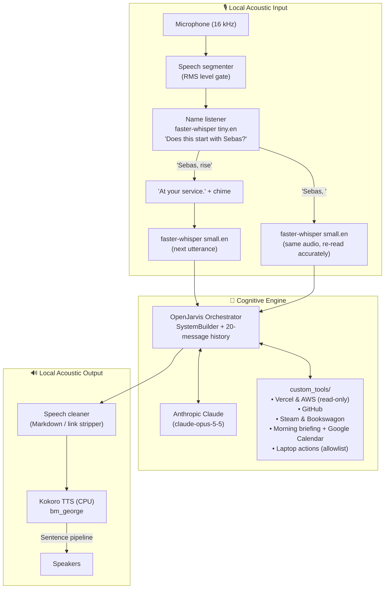

# SEBAS: The Impeccably Polite AI Butler 🎩

[](https://www.python.org/downloads/)
[](LICENSE)
[](https://github.com/hexgrad/kokoro)
[](https://github.com/SYSTRAN/faster-whisper)
[](https://www.anthropic.com/)

> *"At your service."*

**SEBAS** is a voice assistant in the manner of a British butler: unfailingly polite, hyper-competent, concise, and fiercely loyal. Call him by name, *"Sebas, rise"*, and he handles your deployments, pull requests, schedule and laptop.

Built on the **OpenJarvis** agent framework, with **Anthropic Claude** as the reasoning engine. Listening and speaking run entirely on your own machine.

---

## 🏛️ System Architecture



---

## ✨ Key Features

- **Wakes on his name**, with no "Hey Jarvis":
  - *"Sebas, rise."* → he answers *"At your service."* and listens for your request.
  - *"Sebas, open YouTube."* → the request is handled in one breath.
  - Speech that doesn't begin with "Sebas" is transcribed locally and discarded.
- **Local voice pipeline**: `faster-whisper` for listening (`tiny.en` to catch the name, `small.en` for requests, `int8` on CPU) and `Kokoro` for speaking (`bm_george`). Synthesis runs a sentence ahead of playback, so replies flow without pauses.
- **Butler persona**: formal, concise, no emojis or "As an AI...", and calm reports when something fails.
- **Tools**:
  | Area | Tools | Access |
  |---|---|---|
  | DevOps | `vercel_deployments`, `aws_instance_health` | Read-only |
  | GitHub | `github_activity`: your open PRs, review requests, notifications | Read-only |
  | Leisure | `steam_wishlist` (discounts), `bookswagon_new_releases` (new light novels since the last check) | Read-only |
  | Daily | `morning_briefing` (time, weather, Google Calendar), `get_weather` | Read-only |
  | Laptop | `open_app`, `open_website`, `open_workspace`, `run_shortcut`, `system_status`, `set_volume`, `lock_screen`, `set_reminder`, `list_reminders` | Only what `laptop.toml` allows |
- **Modes**: voice, text (`--text`) and microphone calibration (`--mic-test`).

---

## 📂 Repository Structure

```text
sebas/
├── README.md
├── run.bat                          # One-click Windows launcher
└── sebas_main/                      # OpenJarvis framework + Sebas
    ├── run_sebas.py                 # Main loop: voice and text modes
    ├── sebas_bootstrap.py           # Loads .env; one-request API check
    ├── requirements_voice.txt       # Voice pipeline packages
    ├── requirements_tools.txt       # Tool packages (boto3, pycaw)
    ├── .env.template                # Secrets and settings template
    ├── configs/sebas/
    │   ├── config.toml              # Model, persona, enabled tools
    │   └── laptop.toml              # Allowlist of apps, sites, projects, routines
    ├── voice_pipeline/
    │   ├── name_listener.py         # Wakes on "Sebas"
    │   ├── ears.py                  # faster-whisper speech recognition
    │   └── mouth.py                 # Kokoro speech and sentence streaming
    └── custom_tools/
        ├── devops_manager.py        # Vercel, AWS EC2
        ├── github_assistant.py      # PRs, notifications
        ├── leisure_tracker.py       # Steam, Bookswagon
        ├── morning_briefing.py      # Time, weather, calendar
        ├── setup_google_calendar.py # One-time Google sign-in
        └── laptop.py                # Laptop actions and reminders
```

---

## 🚀 Getting Started

### Prerequisites

- **Windows 10/11** (the laptop tools and `run.bat` are Windows-specific)
- **Python 3.12** and [**uv**](https://docs.astral.sh/uv/)
- A microphone and speakers
- An [Anthropic API key](https://console.anthropic.com/)

### Installation

```powershell
git clone https://github.com/krishivvyas/SEBAS.git
cd SEBAS\sebas_main

$env:UV_LINK_MODE = "copy"   # recommended inside OneDrive folders
uv sync --no-dev --extra inference-cloud --python 3.12
uv pip install python-dotenv -r requirements_voice.txt -r requirements_tools.txt
```

The speech models (about 0.5 GB in total) download automatically on first run.

> If you rename or move the `sebas_main` folder, run `uv pip install -e . --no-deps` inside it afterwards, or Python will no longer find the framework.

### Configuration

```powershell
Copy-Item .env.template .env
```

Then fill in `.env`. Only `ANTHROPIC_API_KEY` is required; each tool tells you which key it is missing when you first use it.

| Setting | Used by | Notes |
|---|---|---|
| `ANTHROPIC_API_KEY` | Everything | Required |
| `VERCEL_TOKEN`, `VERCEL_TEAM_ID` | Vercel deployments | Team ID only for team projects |
| `AWS_ACCESS_KEY_ID`, `AWS_SECRET_ACCESS_KEY`, `AWS_DEFAULT_REGION` | EC2 health | Read-only IAM credentials suffice |
| `GITHUB_PAT` | GitHub | Classic token with `repo` and `notifications` scopes; fine-grained tokens cannot read notifications |
| `STEAM_ID`, `STEAM_COUNTRY` | Steam wishlist | 17-digit SteamID64; profile game details must be public |
| `OPENWEATHERMAP_API_KEY`, `SEBAS_HOME_LOCATION` | Weather, briefing | e.g. `Mumbai,IN` |
| `GOOGLE_CLIENT_ID`, `GOOGLE_CLIENT_SECRET` | Calendar in the briefing | See below |
| `SEBAS_VOICE` | Speech | `bm_george` (default), `bm_lewis`, `bm_daniel`, `bm_fable` |
| `SEBAS_SILENCE_THRESHOLD` | Listening | Use the value `--mic-test` suggests (default 500) |
| `SEBAS_NAME_MODEL`, `SEBAS_WHISPER_MODEL` | Listening | Defaults `tiny.en` and `small.en` |

**Google Calendar (optional):** in Google Cloud Console, enable the Google Calendar API, create an OAuth client of type *Desktop app*, put its ID and secret in `.env`, then run this once:

```powershell
.venv\Scripts\python.exe custom_tools\setup_google_calendar.py
```

**Laptop actions:** edit `configs/sebas/laptop.toml` to list the apps, websites, project folders and routines Sebas may open. Nothing outside that file can be launched.

---

## 🎙️ Usage

1. **Calibrate the microphone** (recommended first step):
   ```powershell
   run.bat --mic-test
   ```
   Stay quiet for 3 seconds, then speak. Put the suggested value in `.env` as `SEBAS_SILENCE_THRESHOLD`.

2. **Talk to Sebas**: double-click `run.bat`, wait for *Ready*, then say:
   > *"Sebas, rise."* … *"What does my day look like?"*
   >
   > *"Sebas, how are my Vercel deployments?"*
   >
   > *"Sebas, open workspace."* (he asks which project, then opens it in Antigravity with Claude in the terminal and Gemini in the browser)
   >
   > *"Sebas, remind me in twenty minutes to stretch."*

3. **Text mode** (quiet rooms, testing): `run.bat --text`

4. **API check** (one request, for troubleshooting): `.venv\Scripts\python.exe sebas_bootstrap.py`

---

## ⚙️ Persona Configuration

The model, persona and enabled tools live in [`sebas_main/configs/sebas/config.toml`](sebas_main/configs/sebas/config.toml). The persona is `default_system_prompt` under `[agent]`; the enabled tools are `tools` in the same section.

---

## 🛡️ Privacy

- **Audio never leaves the laptop.** Listening, name detection and speech synthesis run locally on the CPU.
- **Requests do.** The transcribed text of what you say *after* "Sebas", and the results of the tools Sebas uses, are sent to Anthropic's API to compose the reply.
- Secrets stay in `sebas_main/.env`, which git ignores.

---

## 🧪 Status

Every component has been tested on its own and in a full loop with simulated audio and a simulated API. Not yet tested with a live API key, a real microphone and voice, real Vercel/GitHub/AWS/Steam accounts, or the Google sign-in. Long-term memory (OpenJarvis's memory store) needs its optional Rust extension and is not enabled yet; conversation history within a session works.

---

## 📜 License

This project is licensed under the MIT License; see the [LICENSE](LICENSE) file for details.
