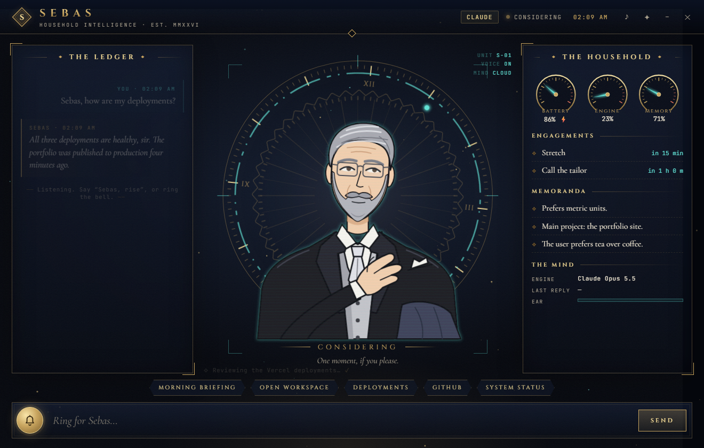
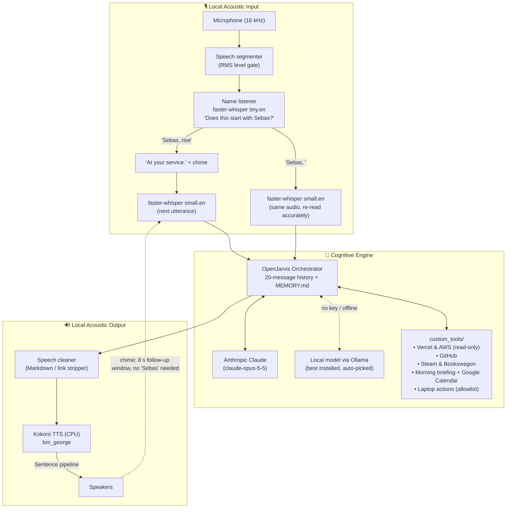

# SEBAS: The Impeccably Polite AI Butler 🎩

[](https://www.python.org/downloads/)
[](LICENSE)
[](https://github.com/hexgrad/kokoro)
[](https://github.com/SYSTRAN/faster-whisper)
[](https://www.anthropic.com/)

> *"At your service."*

**SEBAS** is a voice assistant in the manner of a British butler: unfailingly polite, hyper-competent, concise, and fiercely loyal. Call him by name, *"Sebas, rise"*, and he handles your deployments, pull requests, schedule and laptop.

Built on the **OpenJarvis** agent framework, with **Anthropic Claude** as the reasoning engine and a **local Ollama model** as the fallback when there is no API key or no internet. Listening and speaking always run on your own machine.



---

## 🖥️ The Interface: "Brass & Hologram"

An Edwardian butler's study inside a holographic HUD: brass and ink-navy with holographic cyan for live data, Art Deco frames, and clockwork rings that double as HUD reticles.

- **Sebas himself**, a cel-shaded butler in the clockwork rings, animated in snappy, hand-drawn style:
  | State | What he does |
  |---|---|
  | At rest | Breathes, blinks at irregular intervals |
  | Listening | Tilts his head, raises his brows; the cyan halo follows your voice |
  | Considering | Glances up, glasses glint, the clockwork spins faster |
  | Speaking | Nods as he begins, pats his chest; four mouth shapes follow his voice, with a gold halo |
- **The Ledger** (left): the conversation, plus notices such as switching to the local model.
- **The Household** (right): brass dial gauges for battery, CPU and memory, pending reminders, remembered facts, which mind is in use, and a live microphone meter.
- **The Service Bell** (bottom): type a request, click a quick action (briefing, workspace, deployments, GitHub, status), or ring the bell to talk without saying "Sebas".
- **Activity ticker**: lines like *"Consulting the GitHub ledger…"* while tools run.
- **Extras**: a boot sequence with the crest, synthesised UI sounds (clockwork ticks, a bell; ♪ toggles them), and ambient dust, scanlines and film grain (✦ toggles them).

Voice keeps working while the window is open. Open `sebas_main/ui/index.html` in a browser for a demo without starting Sebas (`?demo=speaking` freezes a state).

---

## 🏛️ System Architecture



---

## ✨ Key Features

- **Wakes on his name**, with no "Hey Jarvis":
  - *"Sebas, rise."* → he answers *"At your service."* and listens for your request.
  - *"Sebas, open YouTube."* → the request is handled in one breath.
  - Speech that doesn't begin with "Sebas" is transcribed locally and discarded.
- **Conversation mode**: after each reply a soft chime means he is still listening for 8 seconds, so follow-ups ("And the other project?") need no "Sebas". Silence ends the conversation.
- **Long-term memory**: *"Sebas, remember that I prefer metric units."* Facts are kept in `~/.openjarvis/MEMORY.md`, a plain file you can read and edit, and are included in every conversation, including after a restart.
- **Local voice pipeline**: `faster-whisper` for listening (`tiny.en` to catch the name, `small.en` for requests, `int8` on CPU) and `Kokoro` for speaking (`bm_george`). Synthesis runs a sentence ahead of playback, so replies flow without pauses.
- **Butler persona**: formal, concise, no emojis or "As an AI...", and calm reports when something fails.
- **Tools**:
  | Area | Tools | Access |
  |---|---|---|
  | DevOps | `vercel_deployments`, `aws_instance_health` | Read-only |
  | GitHub | `github_activity`: your open PRs, review requests, notifications | Read-only |
  | Leisure | `steam_wishlist` (discounts), `bookswagon_new_releases` (new light novels since the last check) | Read-only |
  | Daily | `morning_briefing` (time, weather, Google Calendar), `get_weather` | Read-only |
  | Laptop | `open_app`, `open_website`, `open_workspace`, `run_shortcut`, `system_status`, `set_volume`, `lock_screen`, `set_reminder`, `list_reminders` | Only what `laptop.toml` allows |
  | Memory | `remember`, `forget` | Writes only `MEMORY.md` |
- **Works offline**: with no `ANTHROPIC_API_KEY`, or when Claude can't be reached, Sebas picks the best tool-capable model from `ollama list` and carries on. If the connection drops mid-session he says so, switches, and checks every 5 minutes whether Claude is back.
- **Modes**: voice, text (`--text`) and microphone calibration (`--mic-test`).

---

## 📂 Repository Structure

```text
sebas/
├── README.md
├── run.bat                          # One-click Windows launcher
└── sebas_main/                      # OpenJarvis framework + Sebas
    ├── run_sebas.py                 # Entry point: interface, voice and text modes
    ├── ui_app.py                    # Desktop window (pywebview) and its bridge
    ├── sebas_brain.py               # Claude, or a local Ollama model offline
    ├── sebas_events.py              # Live events from Sebas to the interface
    ├── sebas_bootstrap.py           # Loads .env; one-request API check
    ├── requirements_voice.txt       # Voice pipeline packages
    ├── requirements_tools.txt       # Tool packages (boto3, pycaw)
    ├── requirements_ui.txt          # Interface package (pywebview)
    ├── ui/                          # index.html, style.css, app.js, fonts/
    ├── .env.template                # Secrets and settings template
    ├── configs/sebas/
    │   ├── config.toml              # Model, persona, enabled tools
    │   └── laptop.toml              # Allowlist of apps, sites, projects, routines
    ├── voice_pipeline/
    │   ├── name_listener.py         # Wakes on "Sebas"
    │   ├── ears.py                  # faster-whisper speech recognition
    │   └── mouth.py                 # Kokoro speech and sentence streaming
    └── custom_tools/
        ├── devops_manager.py        # Vercel, AWS EC2
        ├── github_assistant.py      # PRs, notifications
        ├── leisure_tracker.py       # Steam, Bookswagon
        ├── morning_briefing.py      # Time, weather, calendar
        ├── setup_google_calendar.py # One-time Google sign-in
        ├── laptop.py                # Laptop actions and reminders
        └── memory.py                # remember / forget (MEMORY.md)
```

---

## 🚀 Getting Started

### Prerequisites

- **Windows 10/11** (the laptop tools and `run.bat` are Windows-specific)
- **Python 3.12** and [**uv**](https://docs.astral.sh/uv/)
- A microphone and speakers
- An [Anthropic API key](https://console.anthropic.com/), and/or [Ollama](https://ollama.com/) with a tool-capable model for offline use

### Installation

```powershell
git clone https://github.com/krishivvyas/SEBAS.git
cd SEBAS\sebas_main

$env:UV_LINK_MODE = "copy"   # recommended inside OneDrive folders
uv sync --no-dev --extra inference-cloud --python 3.12
uv pip install python-dotenv -r requirements_voice.txt -r requirements_tools.txt -r requirements_ui.txt
```

The speech models (about 0.5 GB in total) download automatically on first run.

> If you rename or move the `sebas_main` folder, run `uv pip install -e . --no-deps` inside it afterwards, or Python will no longer find the framework.

### Configuration

```powershell
Copy-Item .env.template .env
```

Then fill in `.env`. Nothing is strictly required: without `ANTHROPIC_API_KEY` Sebas runs on a local model, and each tool tells you which key it is missing when you first use it.

| Setting | Used by | Notes |
|---|---|---|
| `ANTHROPIC_API_KEY` | Reasoning | Claude; without it Sebas uses a local model |
| `SEBAS_LOCAL_MODEL` | Offline reasoning | Force a model from `ollama list` instead of the automatic choice |
| `VERCEL_TOKEN`, `VERCEL_TEAM_ID` | Vercel deployments | Team ID only for team projects |
| `AWS_ACCESS_KEY_ID`, `AWS_SECRET_ACCESS_KEY`, `AWS_DEFAULT_REGION` | EC2 health | Read-only IAM credentials suffice |
| `GITHUB_PAT` | GitHub | Classic token with `repo` and `notifications` scopes; fine-grained tokens cannot read notifications |
| `STEAM_ID`, `STEAM_COUNTRY` | Steam wishlist | 17-digit SteamID64; profile game details must be public |
| `OPENWEATHERMAP_API_KEY`, `SEBAS_HOME_LOCATION` | Weather, briefing | e.g. `Mumbai,IN` |
| `GOOGLE_CLIENT_ID`, `GOOGLE_CLIENT_SECRET` | Calendar in the briefing | See below |
| `SEBAS_VOICE` | Speech | `bm_george` (default), `bm_lewis`, `bm_daniel`, `bm_fable` |
| `SEBAS_SILENCE_THRESHOLD` | Listening | Use the value `--mic-test` suggests (default 500) |
| `SEBAS_FOLLOW_UP_SECONDS` | Conversation mode | How long to wait for a follow-up (default 8; `0` turns it off) |
| `SEBAS_NAME_MODEL`, `SEBAS_WHISPER_MODEL` | Listening | Defaults `tiny.en` and `small.en` |

**Google Calendar (optional):** in Google Cloud Console, enable the Google Calendar API, create an OAuth client of type *Desktop app*, put its ID and secret in `.env`, then run this once:

```powershell
.venv\Scripts\python.exe custom_tools\setup_google_calendar.py
```

**Laptop actions:** edit `configs/sebas/laptop.toml` to list the apps, websites, project folders and routines Sebas may open. Nothing outside that file can be launched.

---

## 🎙️ Usage

1. **Calibrate the microphone** (recommended first step):
   ```powershell
   run.bat --mic-test
   ```
   Stay quiet for 3 seconds, then speak. Put the suggested value in `.env` as `SEBAS_SILENCE_THRESHOLD`.

2. **Talk to Sebas**: double-click `run.bat`. The interface opens; once the Ledger says *Listening*, say:
   > *"Sebas, rise."* … *"What does my day look like?"*
   >
   > *"Sebas, how are my Vercel deployments?"*
   >
   > *"Sebas, open workspace."* (he asks which project, then opens it in Antigravity with Claude in the terminal and Gemini in the browser)
   >
   > *"Sebas, remind me in twenty minutes to stretch."*
   >
   > *"Sebas, remember that my main project is the portfolio site."*

   Or type in the Service Bell, click a quick action, or ring the bell and just speak.

3. **Other ways to run**:
   | Command | What it opens |
   |---|---|
   | `run.bat` | The interface, with voice |
   | `run.bat --no-voice` | The interface, typing only (no microphone) |
   | `run.bat --console` | Voice only, in the console (no interface) |
   | `run.bat --text` | Typing in the console (quiet rooms, testing) |
   | `run.bat --mic-test` | Microphone calibration |

4. **API check** (one request, for troubleshooting): `.venv\Scripts\python.exe sebas_bootstrap.py`

---

## 🧠 Offline Mode (Local Models)

When `ANTHROPIC_API_KEY` is missing, or `api.anthropic.com` can't be reached, Sebas starts the Ollama server if needed and picks the first installed model from this ranking (`LOCAL_MODEL_PREFERENCE` in `sebas_brain.py`): `qwen2.5` → `llama3.1:8b` → `llama3.2`. If none of those is installed he uses the largest model that supports tool calling. `SEBAS_LOCAL_MODEL` in `.env` overrides the choice.

The ranking comes from a benchmark of Sebas's own requests (laptop status, a reminder, opening a site, remembering a fact, small talk) through his real persona and tools, on an i7-1360P laptop with 16 GB RAM and no GPU:

| Model | Correct tool use | Typical reply | Notes |
|---|---|---|---|
| **qwen2.5 (7.6B)** | **5 / 5** | **5–25 s** | Chosen: accurate and fastest of the capable models |
| llama3.1:8b | 4 / 5 | ~2 min | Ran the morning briefing in reply to "how are you?" |
| llama3.2 (3.2B) | 3 / 5 | ~1 min | Picked the wrong tools for memory and small talk |
| qwen3.5 (9.7B) | 1 / 1 | ~5 min | Too slow on this hardware |
| mistral (7.2B) | 1 / 5 | varies | Never called tools; invented data |
| qwen2.5-coder:1.5b | 1 / 5 | ~1 s | Wrote tool calls as text instead of running them |

What to expect offline:
- **Startup**: the model is preloaded in the background, which takes about 2½ minutes on CPU. A request made during that time waits for it.
- **Replies**: about 25 s for the first, 10–15 s after that, compared with a few seconds on Claude. Answers are also less precise; in testing, `qwen2.5` once misread a memory figure from the status tool.
- **Memory**: the model needs about 5 GB of RAM on top of Sebas's voice models (about 2 GB). With little free memory Windows swaps to disk, and replies slow to minutes. Closing heavy apps helps, or set `SEBAS_LOCAL_MODEL=llama3.2:latest` for a smaller (less reliable) model.

---

## ⚙️ Persona Configuration

The model, persona and enabled tools live in [`sebas_main/configs/sebas/config.toml`](sebas_main/configs/sebas/config.toml). The persona is `default_system_prompt` under `[agent]`; the enabled tools are `tools` in the same section.

---

## 🛡️ Privacy

- **Audio never leaves the laptop.** Listening, name detection and speech synthesis run locally on the CPU.
- **Requests do, when Claude is in use.** The transcribed text of what you say *after* "Sebas", and the results of the tools Sebas uses, are sent to Anthropic's API to compose the reply. On the local model, nothing leaves the laptop except the tools' own API calls.
- Secrets stay in `sebas_main/.env`, which git ignores.

---

## 🧪 Status

Every component has been tested on its own and in a full loop with simulated audio and a simulated API. The interface has been checked in every state through its browser demo. Offline mode has been tested with the real `qwen2.5` model: starting without a key, starting with Claude unreachable, and losing the connection mid-conversation. Not yet tested with a live Claude API key, a real microphone and voice, real Vercel/GitHub/AWS/Steam accounts, or the Google sign-in.

At startup OpenJarvis logs that its optional Rust extension (`openjarvis_rust`) is missing. Sebas does not use the features that need it; memory works through `MEMORY.md` instead.

---

## 📜 License

This project is licensed under the MIT License; see the [LICENSE](LICENSE) file for details.
