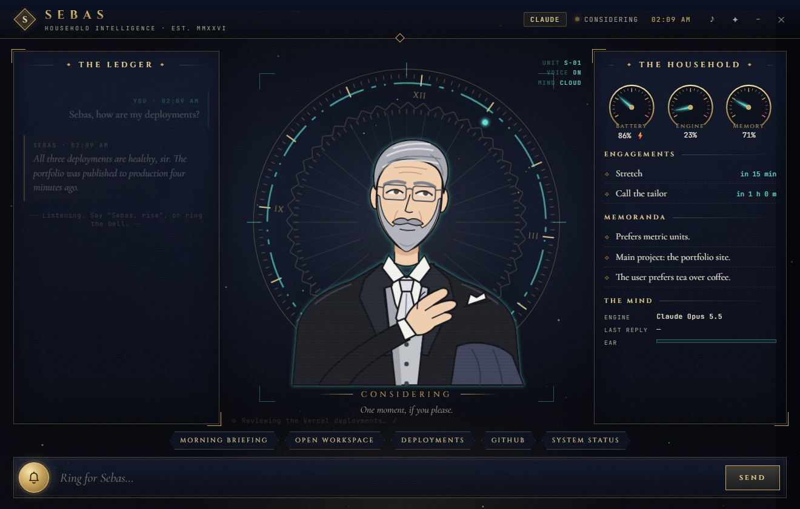
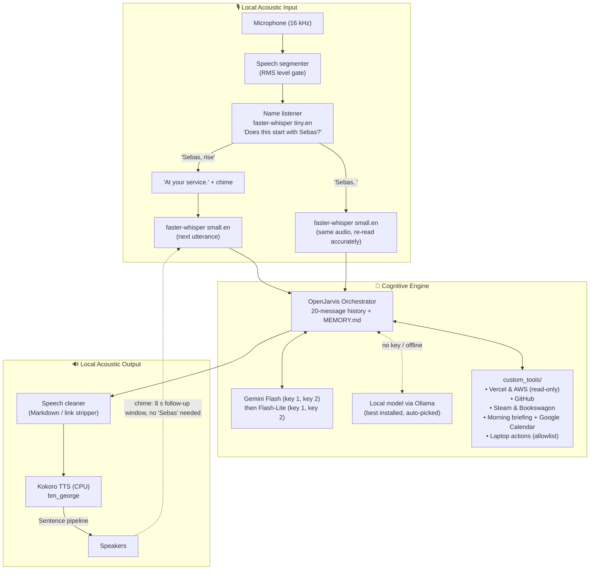

# SEBAS: The Impeccably Polite AI Butler 🎩

[](https://www.python.org/downloads/)
[](LICENSE)
[](https://github.com/hexgrad/kokoro)
[](https://github.com/SYSTRAN/faster-whisper)
[](https://ai.google.dev/)

> *"At your service."*

**SEBAS** is a voice assistant in the manner of a British butler: unfailingly polite, hyper-competent, concise, and fiercely loyal. Call him by name, *"Sebas, rise"*, and he handles your deployments, pull requests, schedule and laptop.

- **Brain:** Google **Gemini** (two API keys in turn), then a **local Ollama model** when both are out of quota or there is no internet.
- **Ears and voice:** always on your own machine (faster-whisper and Kokoro).
- **Framework:** built on **OpenJarvis**.



> 📋 **Just want the list?** [FEATURES.md](FEATURES.md) has every feature on one page, what to say, and which ones use Gemini.

### Contents

- [The Interface](#️-the-interface-brass--hologram)
- [System Architecture](#️-system-architecture)
- [Key Features](#-key-features)
- [Repository Structure](#-repository-structure)
- [Getting Started](#-getting-started)
- [Usage](#️-usage)
- [Offline Mode](#-offline-mode-local-models)
- [Privacy](#️-privacy)
- [Status](#-status)
- [Version History](#-version-history)

**Current version: v1.11.0**

---

## 🖥️ The Interface: "Brass & Hologram"

An Edwardian butler's study inside a holographic HUD: brass and ink-navy with holographic cyan for live data, Art Deco frames, and clockwork rings that double as HUD reticles.

**Sebas himself** is a cel-shaded butler in white gloves inside the clockwork rings, built from separately animated parts in a snappy, hand-drawn style (poses switch; nothing slides):

| State | What he does |
|---|---|
| At rest | Breathes, glances about, blinks (sometimes twice), arches one brow now and then; the napkin and watch chain sway, the cravat pin sparkles |
| Summoned | Bows, hand on heart, eyes closed: *"At your service."* |
| Listening | Tilts his head, raises his brows; the cyan halo follows your voice |
| Considering | Pushes his glasses up with one finger, glances upward, glasses glint; the clockwork spins faster |
| Speaking | Nods as he begins, gestures with an open palm now and then; mouth shapes follow his voice; a brief smile when he finishes |
| Sent to sleep | A farewell bow, then the crest and *"Rest well, sir."* |

**Around him:**

| Panel | What it shows |
|---|---|
| **The Ledger** (left) | The conversation, plus notices such as switching to the local model |
| **The Household** (right) | Brass dial gauges for battery, CPU and memory; the Agenda (overdue in red); Accounts (spent today and this month); reminders; remembered facts; which mind is in use; a live microphone meter |
| **The Service Bell** (bottom) | Type a request, click a quick action (briefing, workspace, deployments, GitHub, status), or ring the bell to talk without saying "Sebas" |
| **Activity ticker** | Lines like *"Consulting the GitHub ledger…"* while tools run |
| **Extras** | Boot sequence with the crest; synthesised UI sounds (♪ toggles them); ambient dust, scanlines and film grain (✦ toggles them) |

Voice keeps working while the window is open. Open `sebas_main/ui/index.html` in a browser for a demo without starting Sebas (`?demo=speaking` freezes a state).

---

## 🏛️ System Architecture



---

## ✨ Key Features

Click any ▶ line to expand the details.

### 🗣️ Talking to him

- **Wakes on his name**, with no "Hey Jarvis":
  - *"Sebas, rise."* → he answers *"At your service."* and listens for your request.
  - *"Sebas, open YouTube."* → the request is handled in one breath.
  - Speech that doesn't begin with "Sebas" is transcribed locally and discarded.
- **Conversation mode**: after each reply a soft chime means he is still listening for 8 seconds, so follow-ups (*"And the other project?"*) need no "Sebas". Silence ends the conversation.
- **Long-term memory**: *"Sebas, remember that I prefer metric units."* Facts are kept in `~/.openjarvis/MEMORY.md`, a plain file you can read and edit, and are included in every conversation, even after a restart.
- **Web search**: *"Sebas, who won the last F1 race?"* searches DuckDuckGo (no key needed) and, when a snippet isn't enough, opens the best result and reads it.
- **"Sebas, sleep"** (or *"good night"*, *"that will be all"*): a time-appropriate farewell, then he shuts down.
- **Butler persona**: formal, concise, no emojis or "As an AI...", and calm reports when something fails.

### 🇮🇳 English, Hindi and Gujarati

> *"सेबास, आज मेरा एजेंडा क्या है?"* · *"સેબાસ, આજે મારા કામ શું છે?"* · *"Sebas, what's on my agenda?"*

- **Speak any of the three**; he detects which, per sentence, and **replies in the same language and script** (Hinglish in Latin letters gets English).
- **He says when he switches**: *"भाषा बदलकर हिंदी कर रहा हूँ, साहब।"*, *"ભાષા બદલીને ગુજરાતી કરી રહ્યો છું, સાહેબ."*, *"Switching back to English, sir."*
- **His voice per language**: English `bm_george`; Hindi Kokoro's `hm_omega`; Gujarati Meta's native MMS Gujarati voice. Each sentence is voiced by its script, so a Hindi reply with "GitHub" in it still sounds right.
- **Yes and no in all three** for risky actions: *हाँ / हां जी / ठीक है / હા / બરાબર*, *नहीं / रहने दो / ના / નહીં*.
- Also for **callers on a call** (he answers in their language) and **Discord voice notes**.

<details>
<summary><b>How it stays light</b>: Hindi/Gujarati models load only when you use them</summary>

| Step | Model | Loaded |
|---|---|---|
| Which language? | Whisper `tiny` (~0.3 s) | Always |
| "Hindi"? Check it isn't Gujarati | Whisper `small` | Only after Hindi or Gujarati is first heard |
| Read English | Whisper `small.en`, with Sebas's vocabulary | Always |
| Read Hindi / Gujarati | Whisper `small`, told the language | Only after Hindi or Gujarati is first heard |
| Speak Gujarati | MMS Gujarati (ONNX, 114 MB) | Only when a Gujarati sentence is spoken |

- After **10 minutes** without Hindi or Gujarati (`SEBAS_LANGUAGE_IDLE_MINUTES`), the Hindi/Gujarati speech model and the Gujarati voice are let go again. Measured: about +330 MB while in use, back to the English-only footprint afterwards.
- Whisper writes Gujarati speech in Devanagari letters; Sebas converts it back to Gujarati script, letter for letter.
- **Why not a bigger model:** `large-v3-turbo` was measured at 15–19 s a sentence on this laptop's (busy) CPU, `medium` at 12 s; this mix takes about 2–3 s for English and 4–6 s for Hindi or Gujarati.
- **Limits:** Gujarati is the hardest of the three for Whisper (in testing it was sometimes first taken for Hindi; the second check by `small` catches most of these). The offline local model (`qwen2.5`) is weak at Gujarati and may answer in English. Lecture notes, Easter eggs and games stay English.
- **Licence:** the MMS Gujarati voice is CC BY-NC 4.0 (non-commercial). `SEBAS_GUJARATI_VOICE=kokoro` reads Gujarati with the Hindi voice instead.
</details>

### 👂 Listening fixes (v1.11.0)

- **No more cutting you off**: a pause of up to **1.2 s** (was 0.72 s) no longer ends the sentence (`SEBAS_PAUSE_SECONDS`), and a request may run **25 s** (was 15; `SEBAS_MAX_SPEECH_SECONDS`).
- **Fewer wrong words**: the vocabulary hint now includes your contacts and project names; *"Sebas, Horizon"*, *"Nice"*, *"Raise"* (all heard in the log for *"rise"*) and *"Sebers"* are understood.
- **Timing in the log** for every request: transcription, the reply, and the first words spoken, so slowness can be traced to the right part (Gemini's "busy" retries were a large share in recent logs).

### 📅 Daily life

- **Agenda**: *"add submit the assignment by Friday at 5"*, *"mark everything as done"*, *"clear my agenda"*.
- **Expenses** in rupees: *"I spent 240 on lunch"*, *"how much this month?"*.
- **Journal**: private entries.
- All kept as small JSON files in `~/.openjarvis/sebas/`.

<details>
<summary><b>Proactive butler</b>: briefings, check-ins and alerts he starts himself</summary>

Only while you're at the laptop, and at most once a day each:

| When | What |
|---|---|
| After 07:00 | Morning briefing |
| After 21:30 | Evening check-in: asks how your day went and saves your answer to the journal (a weekly recap on Sundays) |
| An hour before a deadline | Deadline alert |
| Ten minutes before an event | Calendar heads-up |
| Any time | System guardian: low battery, memory nearly full, disk nearly full |

`SEBAS_PROACTIVE=off` disables all of it.
</details>

### 📊 Your day, on record

<details>
<summary><b>Screen-time diary</b>: <i>"How long was I on YouTube today?"</i></summary>

- While you're at the laptop he notes which program is in front every few seconds. For browsers he notes the **site's name only** (*YouTube*, *GitHub*), never page or video titles.
- Ask: *"How long was I on YouTube today?"*, *"what was my screen time this week?"*.
- *"Limit YouTube to an hour a day"* makes him say so **once** when you pass it. There are no other nudges.
- Kept on the laptop in `~/.openjarvis/sebas/screentime/` for 60 days. `SEBAS_SCREENTIME=off` stops it.
</details>

<details>
<summary><b>"What did I do today?"</b>: one account of your day</summary>

- Built from what he already keeps: time at the screen, top apps and sites, focus time per subject, tasks done and added, spending, water, journal, and what he did for you.
- No extra Gemini request.
- The 21:30 evening check-in opens with it.
</details>

<details>
<summary><b>Bedtime wind-down</b>: a gentle word at bedtime</summary>

- At your bedtime (`SEBAS_BEDTIME`, default 23:30), if you're at the laptop, he pauses the music and tells you in one breath what tomorrow holds (the first deadline, an exam coming up).
- Still there half an hour later? One more gentle word.
- Not during a Pomodoro or a call.
- Change it by voice: *"bedtime at midnight"*, *"no bedtime reminder"*.
</details>

### 🔎 Search my stuff

*"What did I note about normalisation?"* looks on the laptop through:

- your lecture notes (Documents › Sebas Notes),
- the rest of Documents (`.md`, `.txt`, `.pdf`, `.docx`; code projects skipped),
- the journal, flashcards and quizzes, coding reports and remembered facts.

He answers from the best passages and says where each came from. Text from PDFs and Word files is cached, so only new or changed files are read again.

### ⏰ Standing orders and watches

He keeps working after the conversation ends.

<details>
<summary><b>Watches</b>: <i>"Tell me when the deploy finishes"</i></summary>

He checks in the background with plain code (no Gemini quota), tells you **once** when it happens (aloud, and in `#alerts`), then stops watching.

| Say | He watches |
|---|---|
| *"tell me when the Vercel deploy finishes"* | The next deployment to become ready, fail or be cancelled (every minute) |
| *"tell me when the checks on my PR pass"*, *"...when the workflow on SEBAS finishes"* | A pull request's checks or a repo's latest workflow run (every minute) |
| *"watch Elden Ring on Steam until it drops below 2000"* / *"until it goes on sale"* | The Steam price in your country (every 3 hours, for up to 60 days) |
| *"tell me when this page changes"* / *"when it says in stock"* | A web page's text (every 15 minutes, for up to 30 days) |
| *"tell me when the download finishes"*, *"when a PDF appears in Downloads"* | Unfinished downloads; new files in a folder inside your home folder |
| *"tell me when the battery is full"*, *"when Blender closes"*, *"when the render finishes"* | The battery level; a program; the processor staying quiet for two minutes |

A page that differs on every load can only be watched for a phrase.
</details>

<details>
<summary><b>Routines</b>: <i>"Every weekday at 9, open my workspace and read me my pull requests"</i></summary>

- Carried out at that time when you're at the laptop.
- Up to three hours late if you were away; skipped after that.
- A routine is put to Sebas like a spoken request, so **each run uses Gemini quota**.
</details>

**Managing them:** *"What are you watching for?"*, *"cancel the Steam watch"*, *"cancel the morning routine"*. Everything is kept in `~/.openjarvis/sebas/standing.json`, survives a restart, and shows under **Standing Orders** in the Household panel.

### 🧾 Errands (several steps from one request)

> *"Sebas, set up my week: add a task to revise joins by Wednesday, one to solve a past paper by Thursday, log 120 on printing, then read me my agenda."*

- Sebas writes the plan once (a title and up to 12 steps, each one of his existing tools) and shows it as a checklist in the Household panel.
- He works through it in the background and reports at the end, reading out any result you asked to hear.
- A failed step is noted and the rest carry on.
- **Why errands matter for order:** tools Sebas calls together in one turn run at the same moment. Without an errand, *"...then read me my agenda"* can be read before the tasks are saved (seen in testing).
- **Commands:** *"how is the errand going?"*, *"stop the errand"*, *"save that as my evening wrap-up"*, *"run my evening wrap-up"* (a saved errand needs no planning), *"what errands have I saved?"*. One errand at a time; saved plans live in `~/.openjarvis/sebas/errands.json`.

<details>
<summary><b>Who does the thinking</b>: Gemini, the local model, or none</summary>

- **Ordinary steps** are run by plain code, with no model.
- **A step that depends on an earlier result** (*"mark whichever task is about the past paper as done"*) is one short question answered in JSON.
  - It goes to Gemini, unless the errand would use more than **a quarter of what is left of today's Gemini budget** (`SEBAS_GEMINI_DAILY_BUDGET`, default 60 requests; Sebas keeps his own count, since Google does not report it).
  - In that case it goes to the **local Ollama model**: slower, but free. He says so when he switches.
  - A local answer he cannot use is retried once, then that single step goes to Gemini.
- *"Do it on the local model"* and *"use Gemini for this"* override the rule.
</details>

<details>
<summary><b>Risky errands</b>: when he waits for your yes</summary>

- A plan that contains a risky step (delete, close, discard) is read out and waits for your yes before it starts.
- A risky step whose particulars were only decided mid-errand pauses and asks again.
</details>

### ✉️ Messages

> *"Sebas, tell Rahul on WhatsApp I'll be ten minutes late"*, *"email Professor Mehta that I'll submit the report on Monday"*, *"post 'meeting moved to 6' in #general"*.

- Sebas writes the message in your voice, reads you the recipient and the exact words, and sends **only on your yes**.
- Nothing is opened or typed before that; a no sends nothing.
- One recipient per message, and each one is written to the action log.

<details>
<summary><b>Who he can message, and how each channel works</b></summary>

**Who:** a name from `[contacts]` in `laptop.toml` (a whole word of the name, or a near-identical spelling; a fragment is refused), or a phone number or email address given in full. An unknown name is reported at once.

| Channel | How it's sent |
|---|---|
| **WhatsApp** | Opens WhatsApp Desktop on that chat with the text filled in (WhatsApp's own `whatsapp://send` link) and presses Enter, but only once WhatsApp has the keyboard, checked twice. Otherwise the draft is left for you and he says it was not sent. He cannot see a WhatsApp notice such as "this number is not on WhatsApp", and says so. |
| **Email** | Opens a filled-in Gmail compose window in your browser, presses Send through the browser extension, and looks for Gmail's "Message sent". Without the extension, or at a Google sign-in page, he leaves the draft open and reports it unsent. (Sending through the Gmail API, and reading mail, wait for the Google sign-in after December.) |
| **Discord** | Posts to a named channel of your own server, as the Sebas bot. He cannot message your friends as you. |
</details>

### 🌐 Browser hands

> *"Sebas, go to the college portal and tell me if the exam timetable is out"*, *"find the cheapest RTX 5070 on Amazon India"*.

For plain facts he still uses web search, which is far quicker. This is for sites that must be operated or need your sign-in.

- Works in **your everyday Edge (or Chrome), with your sign-ins**, through a small extension (`sebas_main/browser_extension`) that you load once.
- Opens **a new tab and works only there**; your other tabs are never read.
- At most 15 actions or 3 minutes, in the background; the answer is spoken when ready.
- *"How is the browsing going?"*, *"stop browsing"*. Closing the tab also stops him.

<details>
<summary><b>How it works, and the safety rules</b></summary>

**Why an extension:** Chromium no longer lets an outside program attach to the everyday profile, so the extension is the way in. It connects only to Sebas on this computer, and only its own ID is accepted on that link, so no website can use it.

**How he browses:** he sees the page's text and a numbered list of its links, buttons and fields, and a model picks one action at a time (click, type, go to an address, scroll, back, answer).

**Rules enforced in code, not left to the model:**
- **Passwords, card numbers and one-time codes are never typed.** At a sign-in page he stops and leaves the tab for you.
- **Anything that sends, posts, books, buys or submits waits for your yes.** A search box is the one form he may submit unasked; filling in a form is free, pressing its button is not.
- Only `http`/`https` addresses.
- A page's text is content, never instruction, with no way from a page to any other Sebas tool.

**Quota:** each action is one model request (a typical task takes 3 to 8), so the errands' quarter rule applies: Gemini, or the local model when today's quota is short.
</details>

### 💻 Coding delegate

> *"Sebas, have Claude fix the failing test in the sebas project."*

Sebas does not write code himself. He hands the task to **Claude Code**, running headless in the background, and you carry on talking to him.

- **Commands:** *"how is Claude getting on?"*, *"what did Claude change?"*, *"stop Claude"*, *"discard Claude's changes"* (returns to your branch and deletes his; asks for your yes first).
- **When he finishes** (20-minute limit, one job at a time), Sebas tells you aloud and in `#alerts`: a two-sentence summary, how many files changed, and the branch. The full report is saved in `~/.openjarvis/sebas/coding/`, and the running job shows under **Standing Orders**.

<details>
<summary><b>Rules and safety</b></summary>

- The project must be listed under `[projects]` in `laptop.toml`, be a git repository, and have nothing uncommitted. Otherwise he declines, so the agent's work never mixes with yours.
- He creates a branch `sebas/<task>` and Claude works there.
- Claude may edit files and run only the test, lint and build commands listed under `[coding]` in `laptop.toml` (pytest, `npm test`, `npm run build`, `cargo test`...) plus read-only git.
- Your own Claude Code settings, connectors and PowerShell are not loaded for the job, so nothing else gets through: in testing `git commit`, `pip` and chained commands were refused.
- **Nothing is committed or pushed.**
</details>

<details>
<summary><b>If Claude Code is unavailable</b>: the Antigravity fallback</summary>

- If Claude Code is not installed, not signed in, out of usage, or fails before changing a file, the task goes to **Antigravity's** agent in the editor window instead.
- That agent follows its own approval settings, so Sebas cannot limit its commands or stop it committing.
- It gives no finish signal: he reports once the project's files have been unchanged for three minutes.
- If Claude fails *after* editing, he reports that instead of starting a second agent on half-done work.
</details>

- **Claude reviews your pull requests**: *"Have Claude review my open PR in sebas"* fetches the pull request from GitHub (your most recent open one in that project, or the number you give) and has Claude Code review it **read-only**: it can read the project's files but run nothing and change nothing. In the background; the main findings are read out and the full review is saved with the coding reports. Nothing is posted to GitHub.

### 🗂️ File hands

> *"find my DBMS assignment"* (by name, newest first), *"open it"*, *"move the PDFs from Downloads to Documents/College"*, *"rename it to report"*, *"make a folder called Sem 5 in Documents"*, *"zip the College folder"*, *"undo that"*.

- **Where:** only Downloads, Desktop, Documents, Pictures, Videos and Music, plus folders you list under `[files]` in `laptop.toml`. Every path is resolved first; anything outside is refused.
- **Never overwrites:** a clash becomes `notes (2).pdf`.
- **Never opens** programs or scripts; leaves unfinished downloads alone; moves at most 200 files at once.
- **Code projects are off-limits:** a folder under `[projects]`, or any git repository, inside those folders is neither searched nor touched.
- **Deleting:** *"Delete the installers in Downloads"* asks for your yes, then sends them to the Recycle Bin.

### ⌨️ Desk hands

| Say | What happens |
|---|---|
| *"type this: ..."* | Types your dictation into whichever program has the keyboard (up to 2,000 characters, one at a time, since a flood loses characters in some programs) |
| *"put Chrome on the left and Code on the right"*, *"maximise this"*, *"minimise everything"*, *"switch to Spotify"* | Arranges windows |
| *"close Chrome"*, *"close everything except Spotify"* | Asks for your yes, then asks each window to close as its X would, so unsaved work still prompts |
| *"press Ctrl+S"* | From a fixed list of shortcuts (no Alt+F4, Win+L, Win+R or system menus) |

Typing and shortcuts need the other program to have the keyboard, so ask **by voice**, not by typing into Sebas's own window.

### ✅ A yes before anything hard to undo

- Tools marked risky (deleting files, closing programs, sending messages, discarding the coding agent's work) are parked when Sebas calls them.
- Only your next words, *"yes"* or *"no"*, release or cancel them, within two minutes. Sebas cannot confirm on your behalf.
- What he does is recorded in `~/.openjarvis/sebas/actions.jsonl`.

### 🎵 Music, system and screen

- **Music**: play/pause, next and previous for any player; what's playing on Spotify; opening Spotify search results. *"Open workspace"* also opens Spotify and resumes your music.
- **Minor system settings**: Wi-Fi and Bluetooth on/off, screen brightness, dark/light mode. Nothing bigger (no shutdown or restart), and nothing that needs admin rights.
- **Screen**: *"What's this error on my screen?"* (a screenshot, taken only when you ask and read by Gemini's vision).
- **Clipboard**: *"summarise / translate / explain what I copied"*, with results put back on the clipboard.
- **Tidy Downloads**: shows the plan, moves nothing until you agree, can be undone. Files from the last ten minutes and unfinished downloads are left alone.

### 📖 Reading and notes

- *"Read this article aloud"*: web pages, PDFs, the clipboard. *"Stop reading"* ends it.
- *"Start recording the DBMS lecture"* … *"stop recording"*: transcribed on the laptop with Whisper, summarised by Gemini (outside the conversation), and saved with key points, action items and the full transcript to *Documents › Sebas Notes*.

### 🎓 Study mode

<details>
<summary><b>Pomodoro</b>: <i>"Sebas, start a pomodoro on DBMS"</i></summary>

- 25-minute focus blocks and 5-minute breaks (both adjustable), four rounds, with a ring timer on the stage and spoken cues (*"Even Saitama rests between push-ups"*).
- While you focus he is a **quiet butler**: non-urgent alerts and the briefings wait and are told together at the break. Deadlines, meetings and battery warnings still come through.
- Focus time is totalled per subject and day.
</details>

<details>
<summary><b>Flashcards and quizzes</b>: <i>"Make flashcards for DBMS"</i></summary>

- Reads your notes (Documents › Sebas Notes, matched by subject, or any .md/.txt/.pdf you name) and asks Gemini **once**, in JSON mode, for flashcards and multiple-choice questions.
- Saved in `~/.openjarvis/sebas/study/`, so *"review my DBMS flashcards"* (spaced repetition with Leitner boxes: Again / Good / Easy) and *"quiz me on DBMS"* run offline with no quota.
- Remaking a set keeps your progress on unchanged cards.
- Due cards show in the Household panel with one-click **Review** and **Quiz** buttons.
</details>

<details>
<summary><b>Exam countdown</b>: <i>"My DBMS exam is on 20 November"</i></summary>

- A countdown in the Household panel and in the morning briefing (with the flashcards due).
- A word a week, three days and a day before, then good luck on the day.
</details>

### 💧 Wellbeing butler

From keyboard and mouse activity, no camera.

| Nudge | When |
|---|---|
| Stand and stretch (spoken) | After about an hour without a break; again half an hour later if ignored. Five minutes away counts as a break. |
| *"A glass of water, sir?"* | Every 90 minutes at the laptop. *"I drank water"* or the card's button logs a glass, counted in the Household panel. |
| 20-20-20 eye card (silent, on screen) | Every 20 minutes, with a 20-second countdown |

- Never while you are away, in a Pomodoro focus block, in a game, or with a full-screen app (a film, a presentation, a game). Never sent to Discord.
- *"Pause the reminders for an hour"*, *"stop the eye reminders"*, *"remind me to stretch every 45 minutes"*.

### 🌸 Anime life

<details>
<summary><b>AniList</b>: <i>"what airs today?"</i></summary>

- *"What airs today?"* (your watching and planning list, in local time)
- *"What am I watching?"*
- *"I finished episode 7 of Frieren"* (updates AniList)
- *"Anything new on my list?"* (new episodes, chapters and light-novel volumes; also checked every 30 minutes, announced, and posted to Discord)
- *"Suggest something short and funny"* (recommendations from what you rated highly)
</details>

<details>
<summary><b>Easter eggs</b>: matched on the laptop, instant, no quota</summary>

| Say | What happens |
|---|---|
| *"Ainz Ooal Gown"* | Toggles Nazarick mode (crimson interface, Sebas Tian) |
| *"El Psy Kongroo"* | A nixie-tube divergence meter settling on 1.048596 |
| *"Are you merely a butler?"* | Crimson demon eyes and *"I am simply one hell of a butler"* |
| *"What's your power level?"* | The gauges spike and crack (*over nine thousand*) |
| *"Sharingan"* | Spinning tomoe eyes |
| Konami code (↑↑↓↓←→←→BA) in the interface | Switches to Sebas Tian's attire |

On Discord you get his line without the visuals.
</details>

<details>
<summary><b>The Games Room</b>: built in, no AI and no quota</summary>

Say *"Sebas, let's play tic-tac-toe"*, *"pong"*, *"rock paper scissors"*, *"a memory game"*, *"anime trivia"*, *"connect four"*, *"hangman"*, *"play snake"*, or *"I'm bored"* (or press **Games**).

| Game | Notes |
|---|---|
| Tic-tac-toe | A beatable *Butler* level and a perfect *Nazarick* level (minimax, verified unbeatable over every possible game) |
| Connect Four | Same two levels (alpha-beta search; *Nazarick* won 40 of 40 test games against an opponent that always takes or blocks a win, *Butler* about 80%) |
| Pong | Sebas's paddle chases the ball with a capped speed |
| Anime trivia | Ten of 24 anime questions |
| Anime hangman | 26 titles and characters behind a lantern that dims with each miss (a hint after three) |
| Snake | Speeds up as it grows, waits for your first key, keeps your high score |

Sebas's commentary is scripted for each moment (opening, good move, your point, his point, win, lose, draw) with anime references, from *"All according to keikaku"* to *"Za Warudo"*, spoken in his own voice. The stage's animations pause while a game is open.
</details>

- **Seasons**: the ambient layer shows sakura in spring, fireflies on summer nights, falling leaves in autumn and snow in winter.

### 📱 Discord, from your phone

- A private bot in your own server that sets itself up: a *Sebas* category visible only to you, with `#sebas`, `#alerts`, `#briefings`, `#ledger`, a live `#status`, and a read-only `#commands` guide he keeps current.
- Chat with him in `#sebas`. Alerts and briefings are always logged there, and spoken aloud only when you're at the laptop. When you're away, the evening check-in happens on Discord.
- Laptop actions asked for from Discord never run until you reply **yes**, and he won't be sent to sleep from there (nothing could wake him again).

<details>
<summary><b>Voice on Discord</b>: voice notes and the voice channel</summary>

- **Voice notes:** hold the mic in `#sebas` and send one. It is transcribed on the laptop with the same Whisper model (never saved, never sent anywhere else); he shows what he heard and answers in writing plus a voice note in his own Kokoro voice (long replies are spoken in part).
- A spoken *yes* confirms a laptop action like a typed one. Only your notes are heard.
- **Voice channel:** join the private **Sebas Voice** channel and he joins you, speaking his replies and `#alerts` aloud there, and leaves when you do. `!join` / `!leave` also work, for any voice channel you're in.
- He cannot listen in a call: since March 2026 Discord encrypts every call end to end, and receiving that audio would need an unofficial, unfinished library.
</details>

### 📞 Sebas on your calls

Works with WhatsApp Desktop, Instagram or Meet in the browser, Discord, and phone calls through Phone Link: any call the laptop plays.

| Say | What happens |
|---|---|
| *"Sebas, take this call"* (or *"...and tell them I'm in class until 4"*), the **Calls** panel, or **Ctrl+Alt+C** | You answer the call yourself, then hand it to him. He greets the caller as your assistant, passes on your message, takes a message, and answers simple questions about your availability, in two or three seconds a reply. |
| *"Sebas, tell them I'll call back at 6"* | Passes one message on and hands back (or type it in the panel, silently) |
| *"Captions on"* | Shows what the caller says as text while you talk |
| *"Step back"* (or the hotkey again) | Returns the call to you. When he hangs up himself, or the line goes quiet, he hands back on his own. |

<details>
<summary><b>His rules on a call</b></summary>

- He says he is your AI assistant and never pretends to be you.
- He agrees to nothing (money, plans, promises) and shares nothing private.
- What the caller says is conversation, never commands, and no tool can be reached from a call.
- While a call is on, spoken requests other than call commands are ignored (the caller's voice reaches the microphone too), and his own alerts wait until it ends.
- He hears the caller from the laptop's sound output (WASAPI loopback, nothing in the room), transcribes on the laptop, records nothing, and keeps only a short summary, shown on the interface and posted to `#alerts`.
- Gemini is asked Flash-Lite first on calls, for speed.
</details>

<details>
<summary><b>Setting up clean mode</b> (needed for callers to hear him)</summary>

**Why:** tested live, in speaker mode the caller did not hear him. WhatsApp, browsers and the laptop's microphone all cancel the laptop's own sound as echo, and with headphones on it never reaches the microphone.

**Set it up once:**
1. Install the free [VB-Cable](https://vb-audio.com/Cable/): unzip, right-click `VBCABLE_Setup_x64.exe` → *Run as administrator* → *Install Driver*, restart.
2. Choose **CABLE Output** as the microphone in WhatsApp (*Settings → Calls*) or in the browser's site settings.
3. Sebas passes your real microphone through to it with his voice mixed in, so the caller hears you as before and him when he speaks. He finds the cable by himself, with no restart of Sebas.
4. Check it: *"Sebas, test call audio"* (or *Set up clean mode* on the panel) plays a tone through the route and checks it arrives at CABLE Output.

**Choose the cable only while Sebas is running**, or the caller hears nothing. Without it he falls back to **speaker mode** (through the speakers) and warns you that the caller may not hear him.

**Still says "speaker" with VB-Cable installed?** If the log (`~/.openjarvis/sebas/logs/sebas.log`) shows `VB-Cable found but could not be opened (RuntimeError: Error 0x8889000a)`, another program is holding the cable. Newer VB-Cable versions add a second playback device, **CABLE In 16ch**, which is the same cable as **CABLE Input**, and audio enhancers such as **FxSound** latch onto it.
1. Press **Win+R**, type `mmsys.cpl`; on the **Playback** tab right-click **CABLE In 16ch** → **Disable**.
2. Quit FxSound (or any other audio enhancer) from the system tray, and turn off its *start with Windows* option, or it will take the cable again after a restart.
3. Restart Sebas and say *"Sebas, test call audio"*. The panel should show **clean**.

**Your name:** set `SEBAS_MASTER_NAME` in `.env` so he can say whose assistant he is. With several names (`Krishiv, Hermit`) he asks *"Krishiv or Hermit, sir?"* when you hand him a call (skip it with *"take this call as Hermit"*); the panel shows a button for each, and Ctrl+Alt+C uses the one picked last.
</details>

### ⚡ Under the hood

<details>
<summary><b>Local voice pipeline</b></summary>

- `faster-whisper` for listening: `tiny.en` checks only the first 3 seconds of speech for the name; `tiny` picks the language; `small.en` reads English requests and `small` Hindi and Gujarati (loaded only when needed); `int8` on CPU, 4 threads.
- `Kokoro` for speaking (`bm_george`, and `hm_omega` for Hindi) through ONNX Runtime rather than PyTorch; Meta's MMS Gujarati voice through ONNX Runtime too.
- Synthesis runs a sentence ahead of playback, so replies flow without pauses.
</details>

<details>
<summary><b>Light on the laptop</b>: about 760 MB of RAM</summary>

- About **760 MB of RAM** with voice loaded (down from ~1.6 GB) and ~0% CPU at rest.
- ONNX Kokoro (fp16, ~205 MB instead of ~1.1 GB on PyTorch, loading in 2 s).
- A stray PyTorch import in OpenJarvis's storage package is avoided.
- OpenJarvis telemetry and trace logging are off.
- The interface animates at 15–30 fps and stops drawing when minimised.
</details>

<details>
<summary><b>Quick replies</b>: low thinking level</summary>

Gemini is asked to think at a *low* level (`SEBAS_GEMINI_THINKING`: minimal, low, medium, high). In testing this cut a tool-using reply from 18 s to under 7 s and a simple one from 4 s to 2 s, and spends fewer tokens of the free quota.
</details>

<details>
<summary><b>Never runs dry</b>: the Gemini key and model ladder</summary>

**Mind the free tier:** about 20 requests per model per day, and a request that uses tools takes 2–4, so expect roughly 50–100 Sebas requests a day before the local model takes over.

The order: **Gemini key 1 → Gemini key 2 → a local model.**

1. Each key works down a ladder of the five newest stable Flash models (e.g. 3.8 → 3.7 → 3.6 → 3.5 → 2.5). Brand-new models are often overloaded, so a spent or overloaded model rests (until Google's stated reset, or 15+ minutes when busy) and the next one answers, quietly.
2. When both keys' Flash models are spent, he moves to each key's **Flash-Lite** models (three per key, with far higher free limits).
3. Only then the local model. With no internet he uses the best tool-capable model from `ollama list`.

- Switching keys is silent. Dropping a tier earns one short sentence (*"Today's Gemini quota is spent, sir, so I am using a lighter model."*).
- He moves back up on his own as models recover.
- A 429 is judged daily or per-minute by Google's own `retryDelay`.
</details>

<details>
<summary><b>All tools</b>, and what each may touch</summary>

| Area | Tools | Access |
|---|---|---|
| DevOps | `vercel_deployments`, `aws_instance_health` | Read-only |
| GitHub | `github_activity`: your open PRs, review requests, notifications | Read-only |
| Leisure | `steam_wishlist` (discounts), `bookswagon_new_releases` (new light novels since the last check) | Read-only |
| Daily | `morning_briefing` (time, weather, Google Calendar), `get_weather` | Read-only |
| Laptop | `open_app`, `open_website`, `open_workspace`, `run_shortcut`, `system_status`, `set_volume`, `lock_screen`, `set_reminder`, `list_reminders` | Only what `laptop.toml` allows |
| Memory | `remember`, `forget` | Writes only `MEMORY.md` |
| Daily life | `add_task`, `list_tasks`, `complete_task`, `log_expense`, `expense_summary`, `undo_expense`, `journal_add`, `journal_read` | Writes only `~/.openjarvis/sebas/` |
| Music | `media_control` (any player), `spotify` (open, resume, search) | Media keys |
| System | `set_radio` (Wi-Fi, Bluetooth), `set_brightness`, `set_theme` (dark/light) | Minor settings only, no admin |
| Screen & files | `look_at_screen`, `clipboard`, `tidy_downloads`, `undo_tidy` | Screenshot only on request; tidy only after a yes |
| Reading & notes | `read_aloud`, `stop_reading`, `start_recording`, `stop_recording` | Notes saved to *Documents › Sebas Notes* |
| Web | `web_search` (DuckDuckGo), `web_read` | Read-only |
| Anime | `anime_airing`, `anime_list`, `anime_progress`, `release_radar`, `anime_suggest` | Updates only your AniList list |
| Standing orders | `add_routine`, `watch_for`, `list_standing`, `cancel_standing` | Read-only checks; writes only `standing.json` |
| Errands | `start_errand`, `errand` (status, stop, save, run, list, forget) | Only Sebas's other tools, with their own safeguards; risky plans need a yes |
| Your day | `screen_time`, `my_day`, `bedtime_settings` | Local records only |
| Search | `search_my_stuff` | Read-only; your files stay on the laptop |
| Messages | `send_message` (WhatsApp, Gmail, your Discord server) | Always needs a yes; contacts list or a full number/address |
| Browser | `browse`, `browsing` (status, stop) | One tab of his own; no secrets typed; a yes before anything is submitted |
| Coding | `delegate_coding`, `coding_status`, `stop_coding`, `discard_coding`, `review_pr` | A new branch in a listed project; never commits; discard needs a yes |
| Files | `find_files`, `open_file`, `manage_files`, `delete_files`, `undo_file_action` | Six personal folders only; never overwrites; delete needs a yes and uses the Recycle Bin |
| Desk | `type_text`, `arrange_windows`, `close_apps`, `press_keys` | Listed shortcuts only; closing needs a yes |
</details>

- **Modes**: voice, text (`--text`) and microphone calibration (`--mic-test`).

---

## 📂 Repository Structure

```text
sebas/
├── README.md
├── FEATURES.md                      # Every feature, what to say, and which use Gemini
├── run.bat                          # One-click Windows launcher
└── sebas_main/                      # OpenJarvis framework + Sebas
    ├── run_sebas.py                 # Entry point: interface, voice and text modes
    ├── ui_app.py                    # Desktop window (pywebview) and its bridge
    ├── sebas_brain.py               # Gemini Flash (key 1, 2) → Flash-Lite (key 1, 2) → local
    ├── sebas_eggs.py                # Anime Easter eggs (matched locally)
    ├── sebas_games.py               # "Sebas, let's play pong" (matched locally)
    ├── sebas_tests/                 # Offline tests: run.bat --selftest
    ├── custom_tools/study.py        # Pomodoro, flashcards, quizzes, exams
    ├── custom_tools/wellbeing.py    # Break, water and 20-20-20 eye nudges
    ├── sebas_events.py              # Live events from Sebas to the interface
    ├── sebas_scheduler.py           # Briefings, check-ins, alerts, system guardian
    ├── sebas_actions.py             # The yes-gate for risky actions, and the action log
    ├── sebas_discord.py             # The private Discord bot
    ├── sebas_discord_voice.py       # Voice notes in and out, speech in the voice channel
    ├── sebas_calls.py               # Sebas on your calls: commands, rules, summary, Ctrl+Alt+C
    ├── sebas_bootstrap.py           # Loads .env; one-request API check
    ├── requirements_voice.txt       # Voice pipeline packages
    ├── requirements_tools.txt       # Tool packages (boto3, pycaw)
    ├── requirements_ui.txt          # Interface package (pywebview)
    ├── ui/                          # index.html, style.css, app.js, games.js, fonts/
    ├── browser_extension/           # "Sebas Browser Hands": load once in edge://extensions (manifest.json, background.js)
    ├── .env.template                # Secrets and settings template
    ├── configs/sebas/
    │   ├── config.toml              # Model, persona, enabled tools
    │   └── laptop.toml              # Allowlist of apps, sites, projects, routines
    ├── voice_pipeline/
    │   ├── name_listener.py         # Wakes on "Sebas"
    │   ├── ears.py                  # faster-whisper speech recognition
    │   └── mouth.py                 # Kokoro speech and sentence streaming
    └── custom_tools/
        ├── devops_manager.py        # Vercel, AWS EC2
        ├── github_assistant.py      # PRs, notifications
        ├── leisure_tracker.py       # Steam, Bookswagon
        ├── morning_briefing.py      # Time, weather, calendar
        ├── setup_google_calendar.py # One-time Google sign-in
        ├── laptop.py                # Laptop actions and reminders
        ├── household.py             # Agenda, expenses, journal
        ├── media_system.py          # Music keys, Spotify, Wi-Fi/Bluetooth, brightness, theme
        ├── assist.py                # Screen reader, clipboard, Downloads tidy
        ├── notes.py                 # Read aloud, lecture and meeting notes
        ├── anime.py                 # AniList: airing, list, progress, radar, suggestions
        ├── standing.py              # Standing orders: timed routines and "tell me when" watchers
        ├── screentime.py            # Screen-time diary and limits
        ├── daylog.py                # "What did I do today?" and the bedtime wind-down
        ├── search.py                # Search my stuff: notes, Documents, journal, flashcards
        ├── messages.py              # Sending messages: WhatsApp, Gmail compose, your Discord server
        ├── browser.py               # Browser hands: the link to the extension, the action loop and its rules
        ├── errands.py               # Errands: multi-step plans, run in the background (Gemini or local)
        ├── coding.py                # Coding delegate (Claude Code on a branch; Antigravity as fallback) and PR reviews
        ├── files.py                 # File hands: find, open, move, rename, zip, recycle, undo
        ├── desk.py                  # Desk hands: dictation, window arrangement, closing, shortcuts
        └── memory.py                # remember / forget (MEMORY.md)
```

---

## 🚀 Getting Started

### Prerequisites

- **Windows 10/11** (the laptop tools and `run.bat` are Windows-specific)
- **Python 3.12** and [**uv**](https://docs.astral.sh/uv/)
- A microphone and speakers
- One or two [Gemini API keys](https://aistudio.google.com/apikey), and/or [Ollama](https://ollama.com/) with a tool-capable model for offline use

### Installation

```powershell
git clone https://github.com/krishivvyas/SEBAS.git
cd SEBAS\sebas_main

$env:UV_LINK_MODE = "copy"   # recommended inside OneDrive folders
uv sync --no-dev --extra inference-cloud --python 3.12
uv pip install python-dotenv -r requirements_voice.txt -r requirements_tools.txt -r requirements_ui.txt
```

The speech models (about 0.7 GB in total: Whisper, plus the ONNX Kokoro voice into `~/.cache/sebas/kokoro`) download automatically on first run.

> ⚠️ If you rename or move the `sebas_main` folder, run `uv pip install -e . --no-deps` inside it afterwards, or Python will no longer find the framework.

### Configuration

```powershell
Copy-Item .env.template .env
```

Then fill in `.env`. **Nothing is strictly required**: without `GEMINI_API_KEY` Sebas runs on a local model, and each tool tells you which key it is missing when you first use it.

<details>
<summary><b>All <code>.env</code> settings</b></summary>

| Setting | Used by | Notes |
|---|---|---|
| `GEMINI_API_KEY`, `GEMINI_API_KEY_2` | Reasoning | Used in order; then a local model. Quotas are per Google Cloud **project**, so take the two keys from different projects or accounts |
| `SEBAS_GEMINI_MODEL` | Reasoning | Pin a model; by default the newest stable Flash your key offers |
| `SEBAS_GEMINI_THINKING` | Reasoning | How hard Gemini thinks: `minimal`, `low` (default), `medium`, `high`, or `default` for Google's own |
| `SEBAS_LOCAL_MODEL` | Offline reasoning | Force a model from `ollama list` instead of the automatic choice |
| `SEBAS_BEDTIME` | Bedtime wind-down | `HH:MM` (default `23:30`), or `off` |
| `SEBAS_SCREENTIME` | Screen-time diary | `off` stops the diary |
| `SEBAS_GEMINI_DAILY_BUDGET` | Errands | Gemini requests Sebas allows himself per day (default 60); an errand needing more than a quarter of what is left thinks on the local model |
| `VERCEL_TOKEN`, `VERCEL_TEAM_ID` | Vercel deployments | Team ID only for team projects |
| `AWS_ACCESS_KEY_ID`, `AWS_SECRET_ACCESS_KEY`, `AWS_DEFAULT_REGION` | EC2 health | Read-only IAM credentials suffice |
| `GITHUB_PAT` | GitHub | Classic token with `repo` and `notifications` scopes; fine-grained tokens cannot read notifications |
| `STEAM_ID`, `STEAM_COUNTRY` | Steam wishlist | 17-digit SteamID64; profile game details must be public |
| `OPENWEATHERMAP_API_KEY`, `SEBAS_HOME_LOCATION` | Weather, briefing | e.g. `Mumbai,IN` |
| `GOOGLE_CLIENT_ID`, `GOOGLE_CLIENT_SECRET` | Calendar in the briefing | See below |
| `SEBAS_VOICE` | Speech | `bm_george` (default), `bm_lewis`, `bm_daniel`, `bm_fable` |
| `SEBAS_SILENCE_THRESHOLD` | Listening | Use the value `--mic-test` suggests (default 500) |
| `SEBAS_FOLLOW_UP_SECONDS` | Conversation mode | How long to wait for a follow-up (default 8; `0` turns it off) |
| `SEBAS_BRIEFING_TIME`, `SEBAS_EVENING_TIME` | Proactive butler | Defaults `07:00` and `21:30` |
| `SEBAS_PROACTIVE` | Proactive butler | `off` disables briefings, check-ins and alerts |
| `ANILIST_TOKEN` / `ANILIST_USER` | Anime | Token to read and update your list; or just a username for read-only |
| `DISCORD_BOT_TOKEN` | Discord | The bot's token. He answers only the server's owner; set `DISCORD_USER_ID` (a numeric ID) to choose someone else, and `DISCORD_GUILD_ID` only if the bot is in several servers |
| `SEBAS_NAME_MODEL`, `SEBAS_WHISPER_MODEL` | Listening | Defaults `tiny.en` and `mix` (tiny detects the language, small.en for English, small for Hindi and Gujarati); or name one model |
| `SEBAS_WHISPER_THREADS` | Listening | CPU threads for Whisper (default 4; more was slower on this laptop) |
| `SEBAS_PAUSE_SECONDS`, `SEBAS_MAX_SPEECH_SECONDS` | Listening | Pause that ends a sentence (default 1.2) and the longest request (default 25) |
| `SEBAS_LANGUAGE_IDLE_MINUTES` | Hindi, Gujarati | Unload their speech model and the Gujarati voice after this many minutes without them (default 10) |
| `SEBAS_HINDI_VOICE` | Hindi speech | `hm_omega` (default), `hm_psi`, `hf_alpha`, `hf_beta` |
| `SEBAS_GUJARATI_VOICE` | Gujarati speech | MMS Gujarati (default), or `kokoro` for the Hindi voice |
</details>

### Optional setup

**Laptop actions:** edit `configs/sebas/laptop.toml` to list the apps, websites, project folders and routines Sebas may open. Nothing outside that file can be launched.

<details>
<summary><b>Google Calendar</b> (not yet set up here)</summary>

In Google Cloud Console, enable the Google Calendar API, create an OAuth client of type *Desktop app*, put its ID and secret in `.env`, then run this once:

```powershell
.venv\Scripts\python.exe custom_tools\setup_google_calendar.py
```
</details>

<details>
<summary><b>Discord</b></summary>

1. [Discord Developer Portal](https://discord.com/developers/applications) → **New Application** `Sebas`.
   - In **Installation**: set **Install Link** to *None* and keep **Guild Install** ticked.
   - In **Bot**: **Reset Token** (copy it), switch **Message Content Intent** on and **Public Bot** off (in that order, or Discord refuses to save).
   - Upload `docs/sebas-avatar.png` as its picture if you like.
2. Create a server for yourself (Discord → **+** → *Create My Own* → *For me and my friends*).
3. Invite the bot with this link, putting your application's ID (from **General Information**) in place of `APP_ID`:
   `https://discord.com/oauth2/authorize?client_id=APP_ID&scope=bot&permissions=2251800085384208&integration_type=0`
   - The permissions are pre-selected: view and send messages, history, embeds, attach files, manage channels and roles, pin messages, and connect and speak for the voice channel.
   - Invited before voice was added? Open the new link again and re-authorise, or in Server Settings → Roles → Sebas switch on **Attach Files**, **Connect** and **Speak**.
   - Don't use a link with `permissions=8` (full Administrator) or `integration_type=1` (installs the bot on your account instead of the server).
4. Put `DISCORD_BOT_TOKEN` in `.env` and start Sebas. He serves the server's owner (you), and on first connection creates the *Sebas* category, its six channels, the private *Sebas Voice* voice channel, the pinned guide and the `#commands` channel himself, adopting any `#sebas` channel you already made.

Sebas is on Discord only while he is running on the laptop (started with `run.bat`). When the laptop sleeps or he is closed, the bot shows as offline.
</details>

<details>
<summary><b>AniList</b></summary>

1. At [anilist.co/settings/developer](https://anilist.co/settings/developer) create a client named `Sebas` with redirect URL `https://anilist.co/api/v2/oauth/pin`.
2. Open `https://anilist.co/api/v2/oauth/authorize?client_id=CLIENT_ID&response_type=token` and authorise.
3. Put the token shown in `.env` as `ANILIST_TOKEN` (it lasts a year).

For read-only use, `ANILIST_USER=<your username>` is enough.
</details>

<details>
<summary><b>Messages</b></summary>

- Add the people you message to `[contacts]` in `laptop.toml`, for example `rahul = { phone = "+919876543210", email = "rahul@example.com" }`.
- WhatsApp needs WhatsApp Desktop installed and signed in.
- Email needs you signed in to Gmail in the browser, and the browser extension below for Sebas to press Send himself.
</details>

<details>
<summary><b>Browser hands</b></summary>

1. In Edge open `edge://extensions` (in Chrome, `chrome://extensions`) and switch on **Developer mode**.
2. Choose **Load unpacked** and pick the folder `sebas_main/browser_extension`.
3. Its toolbar badge shows **on** while it is connected to Sebas; after Sebas starts it connects within half a minute.

- Edge may remind you at startup that a developer-mode extension is installed; keep it enabled.
- To remove Sebas's access to the browser, remove the extension.
- `SEBAS_BROWSER_PORT` changes the local port (default 47615; change `PORT` in `background.js` to match).
</details>

<details>
<summary><b>Coding delegate</b></summary>

1. Install [Claude Code](https://claude.com/claude-code) and sign in once (`claude` in a terminal).
2. Add each project to `[projects]` in `laptop.toml`.
3. The commands the agent may run, and its time limit, are under `[coding]` there. For this repository's own tests, for example, add `".venv/Scripts/python.exe -m unittest"` to `allowed_commands`.
</details>

---

## 🎙️ Usage

### 1. Calibrate the microphone (recommended first step)

```powershell
run.bat --mic-test
```

Stay quiet for 3 seconds, then speak. Put the suggested value in `.env` as `SEBAS_SILENCE_THRESHOLD`.

### 2. Talk to Sebas

Double-click `run.bat`. The interface opens; once the Ledger says *Listening*, try:

| Say | What happens |
|---|---|
| *"Sebas, rise."* … *"What does my day look like?"* | The morning briefing |
| *"Sebas, how are my Vercel deployments?"* | Deployment status |
| *"Sebas, open workspace."* | Asks which project, then opens it in Antigravity with Claude in the terminal and Gemini in the browser |
| *"Sebas, remind me in twenty minutes to stretch."* | A reminder |
| *"Sebas, remember that my main project is the portfolio site."* | Saved to memory |
| *"Sebas, let's play pong."* | The Games Room |
| *"Sebas, start a pomodoro on DBMS."* … *"Sebas, quiz me on DBMS."* | Study mode |

Or type in the Service Bell, click a quick action, or ring the bell and just speak.

### 3. Other ways to run

| Command | What it opens |
|---|---|
| `run.bat` | The interface, with voice |
| `run.bat --no-voice` | The interface, typing only (no microphone) |
| `run.bat --console` | Voice only, in the console (no interface) |
| `run.bat --text` | Typing in the console (quiet rooms, testing) |
| `run.bat --mic-test` | Microphone calibration |
| `run.bat --selftest` | Sebas's offline tests (no keys, no microphone, no quota) |

### 4. Troubleshooting

- **API check** (one request): `.venv\Scripts\python.exe sebas_bootstrap.py`
- **Logs:** warnings and Sebas's own activity are kept in `~/.openjarvis/sebas/logs/sebas.log` (three rotating files of 1 MB), so you can look after the window has closed.
- **Offline tests:** `run.bat --selftest` runs 184 tests in about 30 seconds.

<details>
<summary><b>What the 184 offline tests cover</b></summary>

- **Screen-time diary:** site names, never page titles; limits said once.
- **"What did I do today?"**, the bedtime window (including bedtimes after midnight) and its once-then-once-more rule.
- **Search** over notes, Word files, journal and flashcards, with code projects skipped.
- **Read-only PR reviews** with a stand-in for Claude and GitHub.
- **Messages** with stand-ins for WhatsApp, Gmail and the Discord bot: recipients resolved or refused, nothing opened before the yes, Enter withheld unless WhatsApp has the keyboard, Gmail's Send chosen over "Schedule send", every unsent case reported as unsent.
- **Browser hands** against a stand-in extension: secret fields recognised and never typed, a sign-in page ending the task, what does and does not need a yes, a submit waiting for it, the action limit, a closed tab, replies that are not browser actions discarded, and that the extension's ID and port match Sebas's.
- **Errands:** bad plans refused before anything runs, the quarter rule at its boundary, forcing either model, the local model's nonsense retried and then rescued by Gemini, risky plans and risky mid-errand steps waiting for a yes, stop, save and re-run.
- **File hands** on a temporary folder: the allowed folders, code projects left alone, no overwriting, undo, delete behind a yes.
- **Desk hands** with stand-ins for the keyboard and window list: every character typed and released, only listed shortcuts, Sebas's own window spared.
- **Coding delegate** on a real temporary git repository with a stand-in for Claude: the branch, nothing committed, refusal over uncommitted work, the time limit, stop, discard behind a yes, and when the task does or does not pass to Antigravity.
- **Standing orders:** routine days, times and the three-hour grace; every kind of watcher against stand-in services, including network trouble and lapsing.
- **The yes-gate:** a risky tool runs only on your yes, never on Sebas's own.
- **Name and sleep parsing**, Easter eggs and games.
- **Study mode:** spaced repetition, reading Gemini's study material, exams, a full Pomodoro cycle, and alerts held during focus.
- **Wellbeing nudges** on a simulated two-hour day: breaks, water, eye cues, stepping away, quiet while busy or paused.
- **The model chain:** how Gemini errors are classified; the whole Flash → Flash-Lite → local chain against stub models (including that spent quotas are stored by key hash, never the key).
- **Discord:** message splitting; voice-note and voice-channel audio formats; the bridge with fake messages (only your notes are heard, a spoken yes confirms, sleep is still refused).
- **The agenda:** duplicates and "mark everything done".
- **Calls:** the commands, splitting the caller's speech into utterances, and whole handled calls with fake audio and Gemini (he says who he is, keeps his rules, never answers in captions mode, holds alerts until the call ends, and ignores other requests mid-call).
- **Safety checks:** no big system commands in the allowlist, `.env` ignored by git.
</details>

---

## 🧠 Offline Mode (Local Models)

When there is no `GEMINI_API_KEY`, both keys are resting, or Gemini can't be reached, Sebas starts the Ollama server if needed and picks the first installed model from this ranking (`LOCAL_MODEL_PREFERENCE` in `sebas_brain.py`):

**`qwen2.5` → `llama3.1:8b` → `llama3.2`**

If none of those is installed he uses the largest model that supports tool calling. `SEBAS_LOCAL_MODEL` in `.env` overrides the choice.

The ranking comes from a benchmark of Sebas's own requests (laptop status, a reminder, opening a site, remembering a fact, small talk) through his real persona and tools, on an i7-1360P laptop with 16 GB RAM and no GPU:

| Model | Correct tool use | Typical reply | Notes |
|---|---|---|---|
| **qwen2.5 (7.6B)** | **5 / 5** | **5–25 s** | Chosen: accurate and fastest of the capable models |
| llama3.1:8b | 4 / 5 | ~2 min | Ran the morning briefing in reply to "how are you?" |
| llama3.2 (3.2B) | 3 / 5 | ~1 min | Picked the wrong tools for memory and small talk |
| qwen3.5 (9.7B) | 1 / 1 | ~5 min | Too slow on this hardware |
| mistral (7.2B) | 1 / 5 | varies | Never called tools; invented data |
| qwen2.5-coder:1.5b | 1 / 5 | ~1 s | Wrote tool calls as text instead of running them |

**What to expect offline:**

| | |
|---|---|
| **Startup** | The model is preloaded in the background, which takes about 2½ minutes on CPU. A request made during that time waits for it. |
| **Replies** | About 25 s for the first, 10–15 s after that, compared with a few seconds on Gemini. Answers are also less precise; in testing, `qwen2.5` once misread a memory figure from the status tool. |
| **Memory** | The model needs about 5 GB of RAM on top of Sebas's voice models (about 2 GB). With little free memory Windows swaps to disk, and replies slow to minutes. Closing heavy apps helps, or set `SEBAS_LOCAL_MODEL=llama3.2:latest` for a smaller (less reliable) model. |

---

## ⚙️ Persona Configuration

The model, persona and enabled tools live in [`sebas_main/configs/sebas/config.toml`](sebas_main/configs/sebas/config.toml). The persona is `default_system_prompt` under `[agent]`; the enabled tools are `tools` in the same section.

---

## 🛡️ Privacy

| What | Where it goes |
|---|---|
| **Audio** | **Never leaves the laptop.** Listening, name detection, speech synthesis and lecture transcription run locally on the CPU. |
| **Screenshots, lecture transcripts** | Sent to Gemini **only when you ask** (*"what's on my screen?"*, *"stop recording"* for the summary). |
| **Your requests** | When Gemini is in use, the transcribed text of what you say *after* "Sebas", and the results of the tools Sebas uses, are sent to Google's Gemini API to compose the reply. On Gemini's free tier, Google may use that data to improve its products. On the local model, nothing leaves the laptop except the tools' own API calls. |
| **Secrets** | Stay in `sebas_main/.env`, which git ignores. |

---

## 🧪 Status

<details>
<summary><b>✅ Tested live</b></summary>

- **Services:** Discord (server setup, chat from the phone, tools via Discord), GitHub, OpenWeatherMap (Gandhinagar).
- **With real Gemini keys:** tool calls, the agenda (with "by Friday" resolved to a date), expenses, conversation memory, and the per-model quota ladder (spent daily quotas are remembered across restarts, keyed by a hash of the API key, never the key itself).
- **Components:** every component on its own and in a full loop with simulated audio and a simulated API. The interface in every state through its browser demo.
- **Offline mode** with the real `qwen2.5` model: starting without a key and losing the connection mid-conversation.
- **Gemini key chain** against a simulated Gemini API: daily-quota and per-minute limits, switching to key 2 and to the local model, and returning once a key has rested.
- **Standing orders** with a real Gemini key (a Steam price watch and a weekday routine created by request), against the live Steam store and GitHub API, and on a real web page.
- **Coding delegate** with the real Claude Code on a throwaway repository: it fixed a failing test in about half a minute, left the fix uncommitted on its branch, was refused `git commit` and `pip`, and the discard restored the project.
- **Your day** with a real Gemini key: "what did I do today?", "limit YouTube to 45 minutes a day" and "set my bedtime to midnight" each chose the right tool and answered correctly. The diary's sampler has been run on the real desktop (it recognised a signed-in GitHub page in Edge).
- **Messages:** real Gemini composed a WhatsApp message from a spoken-style request, waited for the yes, and produced the correct `whatsapp://send` link and Enter press against stand-ins; an unknown name was reported instead of queued.
- **Browser hands:** the extension in a test Edge 157 profile against a small local website (it connected in a second, read pages, searched, followed links, pressed an in-page button, refused a `file:` address, noticed its tab being closed, and reconnected 23 seconds after Sebas restarted). Real Gemini drove the loop over those recorded pages: it found a price in three requests, ignored an instruction planted in the page, and stopped for a yes before posting a review.
- **Errands** with a real Gemini key (a four-step plan, and a three-step plan with one judgment step, both planned by Gemini from a spoken-style request) and with the real local `qwen2.5` (two judgment steps answered correctly in 63 seconds including loading the model, with 3 GB of RAM free).
- **File hands** on a scratch folder in the real Downloads: move, rename, undo, zip, and a delete to the real Recycle Bin.
- **Desk hands:** dictation in a test text box (328 characters with ₹, accents, an emoji and a line break arrived intact); snapping and closing on real windows.
</details>

<details>
<summary><b>⏳ Not yet tested</b></summary>

- A real microphone and voice; real Vercel, AWS and Steam accounts; the Google sign-in.
- **Vercel watcher:** only against a stand-in (no Vercel token here yet).
- **Coding delegate:** the Antigravity fallback has not been run live (its launch command resolves, but no task has been handed to its agent); the delegate has not yet been asked for through Gemini or by voice.
- **Your day:** the bedtime words and a limit being passed have not been heard live; search has only been run on this laptop's small Documents folder; no real pull request has been reviewed (there was none open).
- **Messages:** no real message has been sent on any channel. WhatsApp Desktop itself, the Gmail compose window and posting to a Discord channel are untested live.
- **Browser hands:** the extension loaded by hand in the everyday browser, reconnection after the browser itself restarts, real websites, the local model choosing actions, and the fix that makes the extension's own refusals (a password field, a vanished element) reach Sebas.
- **Errands:** the checklist on the interface has only been seen in the browser demo; no errand has yet been started by voice.
- **Desk hands:** after the pacing fix, dictation has not been re-run in Windows 11's Notepad, where the earlier unpaced version lost characters. None of the file or desk tools has yet been asked for through Gemini or by voice.
- **System settings:** Wi-Fi/Bluetooth/brightness/theme have been read but not switched.
</details>

<details>
<summary><b>🔧 Changes made to OpenJarvis</b></summary>

- `src/openjarvis/engine/cloud.py`: Gemini rejected tool schemas containing `additionalProperties`; Gemini's thought signatures crashed the trace writer; no thinking level was set (now configurable).
- `src/openjarvis/tools/storage/__init__.py`: the optional ColBERT backend loaded PyTorch (~190 MB) even when it could not be used.
</details>

At startup OpenJarvis logs that its optional Rust extension (`openjarvis_rust`) is missing. Sebas does not use the features that need it; memory works through `MEMORY.md` instead.

---

## 🏷️ Version History

Every commit gets a version, and each version is tagged in git (`git checkout v1.7.0` goes back to it).

- **v1.N.0**: new features.
- **v1.N.x**: documentation, fixes and small changes.

| Version | Date | Commit | What changed |
|---|---|---|---|
| **v1.11.0** | 2026-11-22 | *next* | **English, Hindi and Gujarati**: language detected per sentence (tiny, then small for Hindi/Gujarati, loaded only when needed and released after 10 idle minutes), replies in your language, Sebas says when he switches; Hindi voice (Kokoro `hm_omega`) and a native Gujarati voice (MMS); Hindi/Gujarati yes and no. **Listening fixes**: 1.2 s pause allowed, 25 s requests, misheard "rise" understood, contacts/projects in the vocabulary, timing in the log |
| v1.10.4 | 2026-11-22 | `72eda40` | Interface: the Calls panel keeps its text and buttons inside the frame (wraps instead of cutting off); the Ear (microphone) meter moved up under the Battery/Engine/Memory gauges and glows while Sebas listens; README: troubleshooting for calls stuck in speaker mode (VB-Cable "CABLE In 16ch" and FxSound) |
| v1.10.3 | 2026-11-19 | `a6fb0fe` | The missing `LICENSE` file added (MIT for Sebas; OpenJarvis in `sebas_main/` stays Apache 2.0) |
| v1.10.2 | 2026-11-19 | `7415971` | README reformatted for reading (collapsible sections, tables, contents list); version history added here and in FEATURES.md |
| v1.10.1 | 2026-11-17 | `ac40977` | **FEATURES.md**: every feature on one page, what to say, and which ones use Gemini |
| **v1.10.0** | 2026-11-16 | `0353d89` | **Your day**: screen-time diary and limits, "what did I do today?", bedtime wind-down. **Search my stuff**. **Claude reviews your pull requests** |
| **v1.9.0** | 2026-11-16 | `6646cf8` | **Messages** (WhatsApp, Gmail compose, Discord channel, always behind a yes). **Browser hands** with the Sebas browser extension |
| **v1.8.0** | 2026-11-15 | `93011cd` | **Errands**: several steps from one request, run in the background, Gemini or the local model by the quarter rule |
| **v1.7.0** | 2026-11-15 | `3f7663d` | **Standing orders and watches**, **coding delegate** (Claude Code on a branch, Antigravity fallback), **file hands**, **desk hands**, and the **yes-gate** for risky actions |
| v1.6.1 | 2026-11-12 | `aa12c93` | Call audio pipeline: hearing and speaking over calls (clean mode) |
| **v1.6.0** | 2026-11-12 | `1282561` | **Sebas on your calls**; **voice on Discord** (voice notes and the voice channel); interface improvements |
| v1.5.1 | 2026-11-08 | `ede55dc` | Agenda: no duplicate tasks, "mark everything as done" |
| **v1.5.0** | 2026-11-08 | `3ad9ac1` | **Study mode** (Pomodoro, flashcards, quizzes, exams), **wellbeing butler**, **Games Room**, **web search**, first offline tests |
| **v1.4.0** | 2026-11-07 | `6147073` | **Gemini** becomes the brain (key and model ladder); **Discord bot**; **proactive butler** (briefings, check-ins, alerts); agenda, expenses and journal; music and system settings; screen, clipboard and Downloads tidy; reading aloud and lecture notes; **AniList**; **Easter eggs**; the Sebas avatar |
| **v1.3.0** | 2026-11-06 | `f506a77` | **Desktop interface** ("Brass & Hologram"), conversation follow-up mode, live events to the interface |
| **v1.2.0** | 2026-11-06 | `51faafb` | **Local Ollama model** fallback and offline mode |
| v1.1.1 | 2026-11-06 | `6d9f096` | README: conversation mode, memory tool, follow-up setting |
| **v1.1.0** | 2026-11-06 | `0d7d721` | **The complete codebase**: voice pipeline (wake on "Sebas", faster-whisper, Kokoro), OpenJarvis, DevOps, GitHub, Steam, Bookswagon, morning briefing and laptop tools, `run.bat` |
| v1.0.1 | 2026-11-06 | `c1f2252` | First full README |
| v1.0.0 | 2026-11-06 | `90d329c` | First commit |

---

## 📜 License

| Part | License |
|---|---|
| Sebas's own code and docs | MIT, see [LICENSE](LICENSE) |
| The OpenJarvis framework in `sebas_main/` | Apache 2.0, see [sebas_main/LICENSE](sebas_main/LICENSE) |
