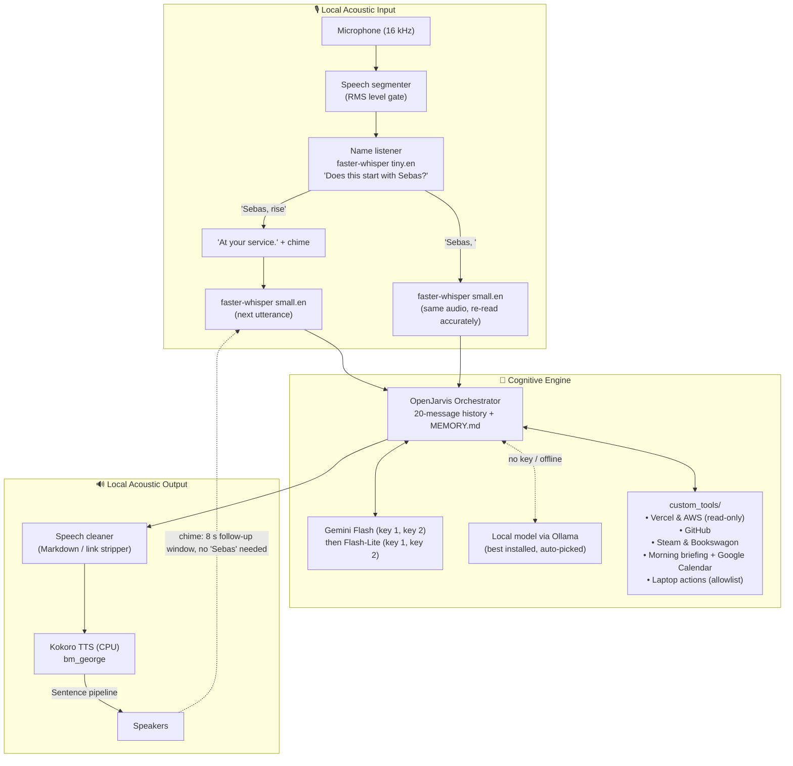

# SEBAS: The Impeccably Polite AI Butler 🎩

[](https://www.python.org/downloads/)
[](LICENSE)
[](https://github.com/hexgrad/kokoro)
[](https://github.com/SYSTRAN/faster-whisper)
[](https://ai.google.dev/)

> *"At your service."*

**SEBAS** is a voice assistant in the manner of a British butler: unfailingly polite, hyper-competent, concise, and fiercely loyal. Call him by name, *"Sebas, rise"*, and he handles your deployments, pull requests, schedule and laptop.

Built on the **OpenJarvis** agent framework, with **Google Gemini** as the reasoning engine: two API keys in turn, then a **local Ollama model** when both are out of quota or there is no internet. Listening and speaking always run on your own machine.


---

## 🖥️ The Interface: "Brass & Hologram"

An Edwardian butler's study inside a holographic HUD: brass and ink-navy with holographic cyan for live data, Art Deco frames, and clockwork rings that double as HUD reticles.

- **Sebas himself**, a cel-shaded butler in white gloves inside the clockwork rings, built from separately animated parts in a snappy, hand-drawn style (poses switch; nothing slides):
  | State | What he does |
  |---|---|
  | At rest | Breathes, glances about, blinks (sometimes twice), arches one brow now and then; the napkin and watch chain sway, the cravat pin sparkles |
  | Summoned | Bows, hand on heart, eyes closed: *"At your service."* |
  | Listening | Tilts his head, raises his brows; the cyan halo follows your voice |
  | Considering | Pushes his glasses up with one finger, glances upward, glasses glint; the clockwork spins faster |
  | Speaking | Nods as he begins, gestures with an open palm now and then; mouth shapes follow his voice; a brief smile when he finishes |
  | Sent to sleep | A farewell bow, then the crest and *"Rest well, sir."* |
- **The Ledger** (left): the conversation, plus notices such as switching to the local model.
- **The Household** (right): brass dial gauges for battery, CPU and memory; the Agenda (to-dos with deadlines, overdue in red); Accounts (spent today and this month); reminders; remembered facts; which mind is in use; and a live microphone meter.
- **The Service Bell** (bottom): type a request, click a quick action (briefing, workspace, deployments, GitHub, status), or ring the bell to talk without saying "Sebas".
- **Activity ticker**: lines like *"Consulting the GitHub ledger…"* while tools run.
- **Extras**: a boot sequence with the crest, synthesised UI sounds (clockwork ticks, a bell; ♪ toggles them), and ambient dust, scanlines and film grain (✦ toggles them).

Voice keeps working while the window is open. Open `sebas_main/ui/index.html` in a browser for a demo without starting Sebas (`?demo=speaking` freezes a state).

---

## 🏛️ System Architecture



---

## ✨ Key Features

- **Wakes on his name**, with no "Hey Jarvis":
  - *"Sebas, rise."* → he answers *"At your service."* and listens for your request.
  - *"Sebas, open YouTube."* → the request is handled in one breath.
  - Speech that doesn't begin with "Sebas" is transcribed locally and discarded.
- **Conversation mode**: after each reply a soft chime means he is still listening for 8 seconds, so follow-ups ("And the other project?") need no "Sebas". Silence ends the conversation.
- **Daily life**: an agenda (*"Sebas, add submit the assignment by Friday at 5"*), an expense log in rupees (*"I spent 240 on lunch"*, *"how much this month?"*) and a private journal, all kept as small JSON files in `~/.openjarvis/sebas/`.
- **Proactive butler**, only while you're at the laptop and at most once a day each: the morning briefing after 07:00; an evening check-in after 21:30 that asks how your day went and saves your answer to the journal (a weekly recap on Sundays); deadline alerts an hour ahead; calendar heads-ups ten minutes before events; and a system guardian for low battery, memory nearly full and disk nearly full. `SEBAS_PROACTIVE=off` disables it.
- **Music and minor system settings**: play/pause, next and previous for any player, what's playing on Spotify, opening Spotify search results; Wi-Fi and Bluetooth on/off, screen brightness, dark/light mode. Nothing bigger (no shutdown or restart), and nothing that needs admin rights. *"Open workspace"* also opens Spotify and resumes your music.
- **Screen, clipboard and files**: *"What's this error on my screen?"* (a screenshot, taken only when you ask and read by Gemini's vision); *"summarise / translate / explain what I copied"*, with results put back on the clipboard; *"tidy my Downloads"* (shows the plan, moves nothing until you agree, can be undone; files from the last ten minutes and unfinished downloads are left alone).
- **Reading and notes**: *"read this article aloud"* (web pages, PDFs, the clipboard; *"stop reading"* ends it); *"start recording the DBMS lecture"* … *"stop recording"*: the recording is transcribed on the laptop with Whisper, summarised by Gemini (outside the conversation), and saved with key points, action items and the full transcript to *Documents › Sebas Notes*.
- **Anime life (AniList)**: *"what airs today?"* (your watching and planning list, in local time), *"what am I watching?"*, *"I finished episode 7 of Frieren"* (updates AniList), *"anything new on my list?"* (new episodes, chapters and light-novel volumes; also checked every 30 minutes and announced, and posted to Discord), and *"suggest something short and funny"* (recommendations from what you rated highly).
- **Web search**: *"Sebas, who won the last F1 race?"* searches DuckDuckGo (no key needed) and, when a snippet isn't enough, opens the best result and reads the page (`web_search`, `web_read`).
- **Anime Easter eggs** (matched on the laptop: instant, no Gemini quota): *"Ainz Ooal Gown"* toggles Nazarick mode (crimson interface, Sebas Tian); *"El Psy Kongroo"* shows a nixie-tube divergence meter settling on 1.048596; *"Are you merely a butler?"* gives crimson demon eyes and *"I am simply one hell of a butler"*; *"What's your power level?"* spikes and cracks the gauges (*over nine thousand*); *"Sharingan"* gives spinning tomoe eyes; the Konami code (up up down down left right left right B A) in the interface switches to Sebas Tian's attire. On Discord you get his line without the visuals.
- **Study mode**:
  - *"Sebas, start a pomodoro on DBMS"*: 25-minute focus blocks and 5-minute breaks (both adjustable), four rounds, with a ring timer on the stage and spoken cues ("Even Saitama rests between push-ups"). While you focus he is a **quiet butler**: non-urgent alerts and the briefings wait and are told together at the break, while deadlines, meetings and battery warnings still come through. Focus time is totalled per subject and day.
  - *"Make flashcards for DBMS"* reads your notes (Documents › Sebas Notes, matched by subject, or any .md/.txt/.pdf you name) and asks Gemini **once**, in JSON mode, for flashcards and multiple-choice questions. They are saved in `~/.openjarvis/sebas/study/`, so *"review my DBMS flashcards"* (spaced repetition with Leitner boxes: Again / Good / Easy) and *"quiz me on DBMS"* run offline with no quota. Remaking a set keeps your progress on unchanged cards. Due cards show in the Household panel with one-click **Review** and **Quiz** buttons.
  - *"My DBMS exam is on 20 November"*: a countdown in the Household panel and in the morning briefing (with the flashcards due), and a word a week, three days and a day before, then good luck on the day.
- **Wellbeing butler** (from keyboard and mouse activity, no camera): after about an hour without a break, a short spoken nudge to stand and stretch (again half an hour later if ignored; five minutes away counts as a break); every 90 minutes at the laptop, *"a glass of water, sir?"* (*"I drank water"* or the card's button logs a glass, counted in the Household panel); and every 20 minutes a silent on-screen 20-20-20 card with a 20-second countdown. Nudges never come while you are away, in a Pomodoro focus block, in a game, or with a full-screen app (a film, a presentation, a game), and never go to Discord. *"Pause the reminders for an hour"*, *"stop the eye reminders"*, *"remind me to stretch every 45 minutes"*.
- **The Games Room** (built in, no AI and no quota): *"Sebas, let's play tic-tac-toe"*, *"pong"*, *"rock paper scissors"*, *"a memory game"*, *"anime trivia"*, *"connect four"*, *"hangman"*, *"play snake"*, or *"I'm bored"* (or press **Games**). Tic-tac-toe has a beatable *Butler* level and a perfect *Nazarick* level (minimax, verified unbeatable over every possible game); Connect Four has the same two levels (alpha-beta search; *Nazarick* won 40 of 40 test games against an opponent that always takes or blocks a win, *Butler* about 80%); in pong Sebas's paddle chases the ball with a capped speed; trivia draws ten of 24 anime questions; anime hangman hides 26 titles and characters behind a lantern that dims with each miss (a hint after three); Snake speeds up as it grows, waits for your first key, and keeps your high score. Sebas's commentary is scripted for each moment (opening, good move, your point, his point, win, lose, draw) with anime references, from *"All according to keikaku"* to *"Za Warudo"*, and spoken in his own voice. The stage's animations pause while a game is open.
- **Seasons**: the ambient layer shows sakura in spring, fireflies on summer nights, falling leaves in autumn and snow in winter.
- **"Sebas, sleep"** (or *"good night"*, *"that will be all"*): a time-appropriate farewell, then he shuts down.
- **Discord, from your phone**: a private bot in your own server that sets itself up (a *Sebas* category visible only to you, with `#sebas`, `#alerts`, `#briefings`, `#ledger`, a live `#status`, and a read-only `#commands` guide he keeps current). Chat with him in `#sebas`; alerts and briefings are always logged there and are spoken aloud only when you're at the laptop; when you're away the evening check-in happens on Discord. Laptop actions asked for from Discord never run until you reply **yes**, and he won't be sent to sleep from there (nothing could wake him again).
- **Long-term memory**: *"Sebas, remember that I prefer metric units."* Facts are kept in `~/.openjarvis/MEMORY.md`, a plain file you can read and edit, and are included in every conversation, including after a restart.
- **Local voice pipeline**: `faster-whisper` for listening (`tiny.en` checks only the first 3 seconds of speech for the name, `small.en` for requests, `int8` on CPU) and `Kokoro` for speaking (`bm_george`) through ONNX Runtime rather than PyTorch. Synthesis runs a sentence ahead of playback, so replies flow without pauses.
- **Light on the laptop**: about **760 MB of RAM** with voice loaded (down from ~1.6 GB) and ~0% CPU at rest. The voice engine uses ONNX Kokoro (fp16, ~205 MB instead of ~1.1 GB on PyTorch, loading in 2 s); a stray PyTorch import in OpenJarvis's storage package is avoided; OpenJarvis telemetry and trace logging are off; the interface animates at 15–30 fps and stops drawing when minimised.
- **Quick replies**: Gemini is asked to think at a *low* level (`SEBAS_GEMINI_THINKING`: minimal, low, medium, high). In testing this cut a tool-using reply from 18 s to under 7 s and a simple one from 4 s to 2 s, and spends fewer tokens of the free quota.
- **Butler persona**: formal, concise, no emojis or "As an AI...", and calm reports when something fails.
- **Tools**:
  | Area | Tools | Access |
  |---|---|---|
  | DevOps | `vercel_deployments`, `aws_instance_health` | Read-only |
  | GitHub | `github_activity`: your open PRs, review requests, notifications | Read-only |
  | Leisure | `steam_wishlist` (discounts), `bookswagon_new_releases` (new light novels since the last check) | Read-only |
  | Daily | `morning_briefing` (time, weather, Google Calendar), `get_weather` | Read-only |
  | Laptop | `open_app`, `open_website`, `open_workspace`, `run_shortcut`, `system_status`, `set_volume`, `lock_screen`, `set_reminder`, `list_reminders` | Only what `laptop.toml` allows |
  | Memory | `remember`, `forget` | Writes only `MEMORY.md` |
  | Daily life | `add_task`, `list_tasks`, `complete_task`, `log_expense`, `expense_summary`, `undo_expense`, `journal_add`, `journal_read` | Writes only `~/.openjarvis/sebas/` |
  | Music | `media_control` (any player), `spotify` (open, resume, search) | Media keys |
  | System | `set_radio` (Wi-Fi, Bluetooth), `set_brightness`, `set_theme` (dark/light) | Minor settings only, no admin |
  | Screen & files | `look_at_screen`, `clipboard`, `tidy_downloads`, `undo_tidy` | Screenshot only on request; tidy only after a yes |
  | Reading & notes | `read_aloud`, `stop_reading`, `start_recording`, `stop_recording` | Notes saved to *Documents › Sebas Notes* |
  | Web | `web_search` (DuckDuckGo), `web_read` | Read-only |
  | Anime | `anime_airing`, `anime_list`, `anime_progress`, `release_radar`, `anime_suggest` | Updates only your AniList list |
- **Never runs dry** (but mind the free tier: about 20 requests per model per day, and a request that uses tools takes 2–4, so expect roughly 50–100 Sebas requests a day before the local model takes over): Gemini key 1 → Gemini key 2 → a local model. Each key works down a ladder of the five newest stable Flash models (e.g. 3.8 → 3.7 → 3.6 → 3.5 → 2.5): the free tier allows only about **20 requests per model per day**, and brand-new models are often overloaded, so a spent or overloaded model rests (until Google's stated reset, or 15+ minutes when busy) and the next one answers, quietly. When both keys' Flash models are spent, he moves to each key's **Flash-Lite** models (three per key, with far higher free limits), and only then to the local model. Switching keys is silent; dropping a tier earns one short sentence (*"Today's Gemini quota is spent, sir, so I am using a lighter model."*). He moves back up on his own as models recover. A 429 is judged daily or per-minute by Google's own `retryDelay`. With no internet he uses the best tool-capable model from `ollama list`.
- **Modes**: voice, text (`--text`) and microphone calibration (`--mic-test`).

---

## 📂 Repository Structure

```text
sebas/
├── README.md
├── run.bat                          # One-click Windows launcher
└── sebas_main/                      # OpenJarvis framework + Sebas
    ├── run_sebas.py                 # Entry point: interface, voice and text modes
    ├── ui_app.py                    # Desktop window (pywebview) and its bridge
    ├── sebas_brain.py               # Gemini Flash (key 1, 2) → Flash-Lite (key 1, 2) → local
    ├── sebas_eggs.py                # Anime Easter eggs (matched locally)
    ├── sebas_games.py               # "Sebas, let's play pong" (matched locally)
    ├── sebas_tests/                 # Offline tests: run.bat --selftest
    ├── custom_tools/study.py        # Pomodoro, flashcards, quizzes, exams
    ├── custom_tools/wellbeing.py    # Break, water and 20-20-20 eye nudges
    ├── sebas_events.py              # Live events from Sebas to the interface
    ├── sebas_scheduler.py           # Briefings, check-ins, alerts, system guardian
    ├── sebas_discord.py             # The private Discord bot
    ├── sebas_bootstrap.py           # Loads .env; one-request API check
    ├── requirements_voice.txt       # Voice pipeline packages
    ├── requirements_tools.txt       # Tool packages (boto3, pycaw)
    ├── requirements_ui.txt          # Interface package (pywebview)
    ├── ui/                          # index.html, style.css, app.js, games.js, fonts/
    ├── .env.template                # Secrets and settings template
    ├── configs/sebas/
    │   ├── config.toml              # Model, persona, enabled tools
    │   └── laptop.toml              # Allowlist of apps, sites, projects, routines
    ├── voice_pipeline/
    │   ├── name_listener.py         # Wakes on "Sebas"
    │   ├── ears.py                  # faster-whisper speech recognition
    │   └── mouth.py                 # Kokoro speech and sentence streaming
    └── custom_tools/
        ├── devops_manager.py        # Vercel, AWS EC2
        ├── github_assistant.py      # PRs, notifications
        ├── leisure_tracker.py       # Steam, Bookswagon
        ├── morning_briefing.py      # Time, weather, calendar
        ├── setup_google_calendar.py # One-time Google sign-in
        ├── laptop.py                # Laptop actions and reminders
        ├── household.py             # Agenda, expenses, journal
        ├── media_system.py          # Music keys, Spotify, Wi-Fi/Bluetooth, brightness, theme
        ├── assist.py                # Screen reader, clipboard, Downloads tidy
        ├── notes.py                 # Read aloud, lecture and meeting notes
        ├── anime.py                 # AniList: airing, list, progress, radar, suggestions
        └── memory.py                # remember / forget (MEMORY.md)
```

---

## 🚀 Getting Started

### Prerequisites

- **Windows 10/11** (the laptop tools and `run.bat` are Windows-specific)
- **Python 3.12** and [**uv**](https://docs.astral.sh/uv/)
- A microphone and speakers
- One or two [Gemini API keys](https://aistudio.google.com/apikey), and/or [Ollama](https://ollama.com/) with a tool-capable model for offline use

### Installation

```powershell
git clone https://github.com/krishivvyas/SEBAS.git
cd SEBAS\sebas_main

$env:UV_LINK_MODE = "copy"   # recommended inside OneDrive folders
uv sync --no-dev --extra inference-cloud --python 3.12
uv pip install python-dotenv -r requirements_voice.txt -r requirements_tools.txt -r requirements_ui.txt
```

The speech models (about 0.7 GB in total: Whisper, plus the ONNX Kokoro voice into `~/.cache/sebas/kokoro`) download automatically on first run.

> If you rename or move the `sebas_main` folder, run `uv pip install -e . --no-deps` inside it afterwards, or Python will no longer find the framework.

### Configuration

```powershell
Copy-Item .env.template .env
```

Then fill in `.env`. Nothing is strictly required: without `GEMINI_API_KEY` Sebas runs on a local model, and each tool tells you which key it is missing when you first use it.

| Setting | Used by | Notes |
|---|---|---|
| `GEMINI_API_KEY`, `GEMINI_API_KEY_2` | Reasoning | Used in order; then a local model. Quotas are per Google Cloud **project**, so take the two keys from different projects or accounts |
| `SEBAS_GEMINI_MODEL` | Reasoning | Pin a model; by default the newest stable Flash your key offers |
| `SEBAS_GEMINI_THINKING` | Reasoning | How hard Gemini thinks: `minimal`, `low` (default), `medium`, `high`, or `default` for Google's own |
| `SEBAS_LOCAL_MODEL` | Offline reasoning | Force a model from `ollama list` instead of the automatic choice |
| `VERCEL_TOKEN`, `VERCEL_TEAM_ID` | Vercel deployments | Team ID only for team projects |
| `AWS_ACCESS_KEY_ID`, `AWS_SECRET_ACCESS_KEY`, `AWS_DEFAULT_REGION` | EC2 health | Read-only IAM credentials suffice |
| `GITHUB_PAT` | GitHub | Classic token with `repo` and `notifications` scopes; fine-grained tokens cannot read notifications |
| `STEAM_ID`, `STEAM_COUNTRY` | Steam wishlist | 17-digit SteamID64; profile game details must be public |
| `OPENWEATHERMAP_API_KEY`, `SEBAS_HOME_LOCATION` | Weather, briefing | e.g. `Mumbai,IN` |
| `GOOGLE_CLIENT_ID`, `GOOGLE_CLIENT_SECRET` | Calendar in the briefing | See below |
| `SEBAS_VOICE` | Speech | `bm_george` (default), `bm_lewis`, `bm_daniel`, `bm_fable` |
| `SEBAS_SILENCE_THRESHOLD` | Listening | Use the value `--mic-test` suggests (default 500) |
| `SEBAS_FOLLOW_UP_SECONDS` | Conversation mode | How long to wait for a follow-up (default 8; `0` turns it off) |
| `SEBAS_BRIEFING_TIME`, `SEBAS_EVENING_TIME` | Proactive butler | Defaults `07:00` and `21:30` |
| `SEBAS_PROACTIVE` | Proactive butler | `off` disables briefings, check-ins and alerts |
| `ANILIST_TOKEN` / `ANILIST_USER` | Anime | Token to read and update your list; or just a username for read-only |
| `DISCORD_BOT_TOKEN` | Discord | The bot's token. He answers only the server's owner; set `DISCORD_USER_ID` (a numeric ID) to choose someone else, and `DISCORD_GUILD_ID` only if the bot is in several servers |
| `SEBAS_NAME_MODEL`, `SEBAS_WHISPER_MODEL` | Listening | Defaults `tiny.en` and `small.en` |

**Google Calendar (optional; not yet set up here):** in Google Cloud Console, enable the Google Calendar API, create an OAuth client of type *Desktop app*, put its ID and secret in `.env`, then run this once:

```powershell
.venv\Scripts\python.exe custom_tools\setup_google_calendar.py
```

**Discord (optional):**

1. [Discord Developer Portal](https://discord.com/developers/applications) → **New Application** `Sebas`. In **Installation**: set **Install Link** to *None* and keep **Guild Install** ticked. In **Bot**: **Reset Token** (copy it), switch **Message Content Intent** on and **Public Bot** off (in that order, or Discord refuses to save). Upload `docs/sebas-avatar.png` as its picture if you like.
2. Create a server for yourself (Discord → **+** → *Create My Own* → *For me and my friends*).
3. Invite the bot with this link, putting your application's ID (from **General Information**) in place of `APP_ID`; the permissions are pre-selected (view and send messages, history, embeds, manage channels and roles, pin messages):
   `https://discord.com/oauth2/authorize?client_id=APP_ID&scope=bot&permissions=2251800082205712&integration_type=0`
   (Don't use a link with `permissions=8`, which is full Administrator, or `integration_type=1`, which installs the bot on your account instead of the server.)
4. Put `DISCORD_BOT_TOKEN` in `.env` and start Sebas. He serves the server's owner (you), and on first connection creates the *Sebas* category, its six channels, the pinned guide and the `#commands` channel himself, adopting any `#sebas` channel you already made.

Sebas is on Discord only while he is running on the laptop (started with `run.bat`); when the laptop sleeps or he is closed, the bot shows as offline.

**AniList (optional):** at [anilist.co/settings/developer](https://anilist.co/settings/developer) create a client named `Sebas` with redirect URL `https://anilist.co/api/v2/oauth/pin`; open `https://anilist.co/api/v2/oauth/authorize?client_id=CLIENT_ID&response_type=token`, authorise, and put the token shown in `.env` as `ANILIST_TOKEN` (it lasts a year). For read-only use, `ANILIST_USER=<your username>` is enough.

**Laptop actions:** edit `configs/sebas/laptop.toml` to list the apps, websites, project folders and routines Sebas may open. Nothing outside that file can be launched.

---

## 🎙️ Usage

1. **Calibrate the microphone** (recommended first step):
   ```powershell
   run.bat --mic-test
   ```
   Stay quiet for 3 seconds, then speak. Put the suggested value in `.env` as `SEBAS_SILENCE_THRESHOLD`.

2. **Talk to Sebas**: double-click `run.bat`. The interface opens; once the Ledger says *Listening*, say:
   > *"Sebas, rise."* … *"What does my day look like?"*
   >
   > *"Sebas, how are my Vercel deployments?"*
   >
   > *"Sebas, open workspace."* (he asks which project, then opens it in Antigravity with Claude in the terminal and Gemini in the browser)
   >
   > *"Sebas, remind me in twenty minutes to stretch."*
   >
   > *"Sebas, remember that my main project is the portfolio site."*
   >
   > *"Sebas, let's play pong."*
   >
   > *"Sebas, start a pomodoro on DBMS."* … *"Sebas, quiz me on DBMS."*

   Or type in the Service Bell, click a quick action, or ring the bell and just speak.

3. **Other ways to run**:
   | Command | What it opens |
   |---|---|
   | `run.bat` | The interface, with voice |
   | `run.bat --no-voice` | The interface, typing only (no microphone) |
   | `run.bat --console` | Voice only, in the console (no interface) |
   | `run.bat --text` | Typing in the console (quiet rooms, testing) |
   | `run.bat --mic-test` | Microphone calibration |
   | `run.bat --selftest` | Sebas's offline tests (no keys, no microphone, no quota) |

4. **API check** (one request, for troubleshooting): `.venv\Scripts\python.exe sebas_bootstrap.py`

5. **When something goes wrong**: warnings and Sebas's own activity are kept in `~/.openjarvis/sebas/logs/sebas.log` (three rotating files of 1 MB), so you can look after the window has closed. `run.bat --selftest` runs 28 offline tests in about 5 seconds: name and sleep parsing, Easter eggs and games, study mode (spaced repetition, reading Gemini's study material, exams, a full Pomodoro cycle, and alerts held during focus), wellbeing nudges on a simulated two-hour day (breaks, water, eye cues, stepping away, quiet while busy or paused), how Gemini errors are classified, the whole Flash → Flash-Lite → local chain against stub models (including that spent quotas are stored by key hash, never the key), Discord message splitting, and safety checks (no big system commands in the allowlist, `.env` ignored by git).

---

## 🧠 Offline Mode (Local Models)

When there is no `GEMINI_API_KEY`, both keys are resting, or Gemini can't be reached, Sebas starts the Ollama server if needed and picks the first installed model from this ranking (`LOCAL_MODEL_PREFERENCE` in `sebas_brain.py`): `qwen2.5` → `llama3.1:8b` → `llama3.2`. If none of those is installed he uses the largest model that supports tool calling. `SEBAS_LOCAL_MODEL` in `.env` overrides the choice.

The ranking comes from a benchmark of Sebas's own requests (laptop status, a reminder, opening a site, remembering a fact, small talk) through his real persona and tools, on an i7-1360P laptop with 16 GB RAM and no GPU:

| Model | Correct tool use | Typical reply | Notes |
|---|---|---|---|
| **qwen2.5 (7.6B)** | **5 / 5** | **5–25 s** | Chosen: accurate and fastest of the capable models |
| llama3.1:8b | 4 / 5 | ~2 min | Ran the morning briefing in reply to "how are you?" |
| llama3.2 (3.2B) | 3 / 5 | ~1 min | Picked the wrong tools for memory and small talk |
| qwen3.5 (9.7B) | 1 / 1 | ~5 min | Too slow on this hardware |
| mistral (7.2B) | 1 / 5 | varies | Never called tools; invented data |
| qwen2.5-coder:1.5b | 1 / 5 | ~1 s | Wrote tool calls as text instead of running them |

What to expect offline:
- **Startup**: the model is preloaded in the background, which takes about 2½ minutes on CPU. A request made during that time waits for it.
- **Replies**: about 25 s for the first, 10–15 s after that, compared with a few seconds on Gemini. Answers are also less precise; in testing, `qwen2.5` once misread a memory figure from the status tool.
- **Memory**: the model needs about 5 GB of RAM on top of Sebas's voice models (about 2 GB). With little free memory Windows swaps to disk, and replies slow to minutes. Closing heavy apps helps, or set `SEBAS_LOCAL_MODEL=llama3.2:latest` for a smaller (less reliable) model.

---

## ⚙️ Persona Configuration

The model, persona and enabled tools live in [`sebas_main/configs/sebas/config.toml`](sebas_main/configs/sebas/config.toml). The persona is `default_system_prompt` under `[agent]`; the enabled tools are `tools` in the same section.

---

## 🛡️ Privacy

- **Audio never leaves the laptop.** Listening, name detection, speech synthesis and lecture transcription run locally on the CPU.
- **Screenshots and lecture transcripts are sent to Gemini only when you ask** (*"what's on my screen?"*, *"stop recording"* for the summary).
- **Requests do, when Gemini is in use.** The transcribed text of what you say *after* "Sebas", and the results of the tools Sebas uses, are sent to Google's Gemini API to compose the reply. On Gemini's free tier, Google may use that data to improve its products. On the local model, nothing leaves the laptop except the tools' own API calls.
- Secrets stay in `sebas_main/.env`, which git ignores.

---

## 🧪 Status

Tested live: Discord (server setup, chat from the phone, tools via Discord), GitHub, OpenWeatherMap (Gandhinagar), and with real Gemini keys: tool calls, the agenda (with "by Friday" resolved to a date), expenses, conversation memory, and the per-model quota ladder (spent daily quotas are remembered across restarts, keyed by a hash of the API key, never the key itself). OpenJarvis changes made on the way: in `src/openjarvis/engine/cloud.py`, Gemini rejected tool schemas containing `additionalProperties`, Gemini's thought signatures crashed the trace writer, and no thinking level was set (now configurable); in `src/openjarvis/tools/storage/__init__.py`, the optional ColBERT backend loaded PyTorch (~190 MB) even when it could not be used. Every component has also been tested on its own and in a full loop with simulated audio and a simulated API. The interface has been checked in every state through its browser demo. Offline mode has been tested with the real `qwen2.5` model: starting without a key and losing the connection mid-conversation. The Gemini key chain has been tested against a simulated Gemini API: daily-quota and per-minute limits, switching to key 2 and to the local model, and returning once a key has rested. Wi-Fi/Bluetooth/brightness/theme have been read but not switched in testing. Not yet tested with a real microphone and voice, real Vercel/GitHub/AWS/Steam accounts, or the Google sign-in.

At startup OpenJarvis logs that its optional Rust extension (`openjarvis_rust`) is missing. Sebas does not use the features that need it; memory works through `MEMORY.md` instead.

---

## 📜 License

This project is licensed under the MIT License; see the [LICENSE](LICENSE) file for details.
