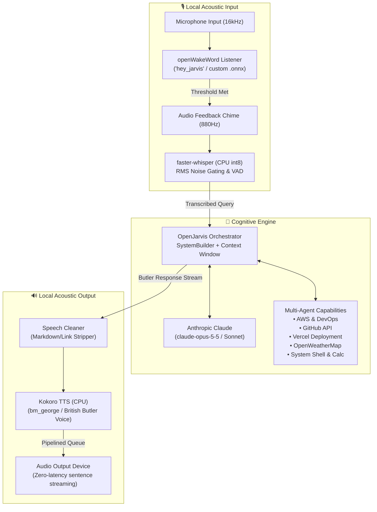

# SEBAS: The Impeccably Polite AI Butler 🎩

[](https://www.python.org/downloads/)
[](LICENSE)
[](https://github.com/hexgrad/kokoro)
[](https://github.com/SYSTRAN/faster-whisper)
[](https://www.anthropic.com/)

> *"At your service, Master."*

**SEBAS** is an advanced, privacy-focused voice assistant and multi-agent orchestrator inspired by the quintessential British butler archetype: unfailingly polite, hyper-competent, concise, and fiercely loyal.

Built atop the **OpenJarvis** agent framework and powered by **Anthropic Claude**, SEBAS combines on-device neural voice intelligence with autonomous system management, DevOps capabilities, and daily scheduling assistance.

---

## 🏛️ System Architecture



---

## ✨ Key Features

- **Local Neural Voice Pipeline**:
  - **Wake Word Detection**: Runs entirely locally via `openwakeword` using ONNX runtime with zero cloud latency.
  - **Speech-to-Text (`Ears`)**: High-accuracy local speech transcription with `faster-whisper` (`small.en`, quantized `int8`), featuring dynamic peak-RMS noise gating to eliminate silent hallucinations.
  - **Text-to-Speech (`Mouth`)**: Natural British butler synthesis powered by `Kokoro TTS` (`bm_george`, `bm_lewis`, `bm_daniel`, `bm_fable`). Audio is synthesized and streamed ahead of playback sentence-by-sentence to eliminate inter-sentence pauses.
- **Refined Butler Persona**:
  - Unwavering formal elegance, dignified warmth, and precise diction.
  - Free from emojis, robotic disclaimers (*"As an AI..."*), or filler text.
  - Proactive error handling with calm explanations and instant troubleshooting suggestions.
- **Autonomous Multi-Agent Orchestration**:
  - Integrated with cloud infrastructure management (AWS, Vercel), GitHub, weather intelligence, and local tools.
  - Rolling conversation history buffer preserving context across multi-turn interactions.
- **Multiple Modes of Operation**:
  - **Voice Mode**: Full hands-free ambient butler loop.
  - **Text Mode**: Keyboard-driven CLI interaction for quiet or terminal environments.
  - **Calibration Utility**: Built-in acoustic analyzer measuring ambient noise and computing recommended silence thresholds.

---

## 📂 Repository Structure

```text
sebas/
├── README.md                      # Project documentation
├── run.bat                        # One-click Windows launcher
└── sebas_main/                    # Core application directory
    ├── run_sebas.py               # Main voice and text assistant loop
    ├── sebas_bootstrap.py         # System test and configuration bootstrap
    ├── requirements_voice.txt     # Python dependencies for the voice pipeline
    ├── .env.template              # Environment variable secrets template
    ├── configs/
    │   └── sebas/
    │       └── config.toml        # Sebas prompt, models, and runtime config
    └── voice_pipeline/            # Local audio components
        ├── wake_word.py           # ONNX-based wake word listener
        ├── ears.py                # faster-whisper speech recognition
        └── mouth.py               # Kokoro TTS engine & sentence streamer
```

---

## 🚀 Getting Started

### Prerequisites

- **OS**: Windows, macOS, or Linux (Windows batch scripts included)
- **Python**: 3.10+ (tested on Python 3.12)
- **Git** & **uv** / **pip**
- Working microphone and speakers / headphones

---

### Installation

1. **Clone the repository**:
   ```bash
   git clone https://github.com/krishivvyas/SEBAS.git
   cd SEBAS
   ```

2. **Navigate to the core project directory**:
   ```bash
   cd sebas_main
   ```

3. **Create and activate a virtual environment**:
   ```bash
   # Using uv (recommended for ultra-fast setup):
   uv venv .venv
   .venv\Scripts\activate   # On Windows
   # source .venv/bin/activate  # On macOS/Linux

   # Or using standard python:
   python -m venv .venv
   .venv\Scripts\activate
   ```

4. **Install dependencies**:
   ```bash
   # Install the voice pipeline packages
   pip install -r requirements_voice.txt

   # Install the base framework in editable mode
   pip install -e .
   ```

---

### Configuration

Copy the template environment file to `.env`:

```bash
# Windows PowerShell:
Copy-Item .env.template .env

# Bash / Linux / macOS:
cp .env.template .env
```

Open `.env` in your editor and configure your credentials:

```ini
# Required: Anthropic Claude API Key
ANTHROPIC_API_KEY=sk-ant-api03-...

# Optional Cloud & DevOps Integrations
AWS_ACCESS_KEY_ID=
AWS_SECRET_ACCESS_KEY=
AWS_DEFAULT_REGION=us-east-1
GITHUB_PAT=
VERCEL_TOKEN=
OPENWEATHERMAP_API_KEY=

# Voice Pipeline Customization (defaults shown)
SEBAS_WAKE_MODEL=hey_jarvis         # built-in model or path to .onnx file
SEBAS_WAKE_THRESHOLD=0.5            # sensitivity (0.0 to 1.0)
SEBAS_WHISPER_MODEL=small.en        # faster-whisper model
SEBAS_VOICE=bm_george               # bm_george, bm_lewis, bm_daniel, bm_fable
SEBAS_SILENCE_THRESHOLD=500         # determined by --mic-test
```

---

## 🎙️ Usage

### 1. Acoustic Calibration (Recommended first step)
Measure your room's background noise floor and calculate an optimal silence threshold:

```bash
python run_sebas.py --mic-test
```
*Remain quiet for 3 seconds, then speak normally. The tool will suggest an optimal `SEBAS_SILENCE_THRESHOLD` for your `.env`.*

### 2. Sanity Check
Test the orchestration engine with a single dry-run request:

```bash
python sebas_bootstrap.py
```

### 3. Voice Mode (Hands-Free Butler)
Launch Sebas in full listening mode:

```bash
python run_sebas.py
```
*(On Windows, you can also simply double-click `run.bat` from the root directory).*

Say:
> *"Hey Jarvis, what is on my schedule today?"*

### 4. Text Mode (Terminal Chat)
Run in terminal-only conversational mode:

```bash
python run_sebas.py --text
```

---

## ⚙️ Persona Configuration

Sebas's core persona and behavior parameters are defined in [`configs/sebas/config.toml`](file:///c:/Users/krish/OneDrive/Desktop/imp/sebas/sebas_main/configs/sebas/config.toml):

```toml
[intelligence]
default_model = "claude-opus-5-5"
preferred_engine = "cloud"
max_tokens = 16000

[agent]
default_agent = "orchestrator"
max_turns = 10
default_system_prompt = '''
You are Sebas, an impeccably polite, hyper-competent, and fiercely loyal AI butler.
Tone: Formal elegance, refined vocabulary, concise and precise.
Never use emojis or robotic phrasing.
'''
```

---

## 🛡️ Privacy & Performance

- **100% On-Device Audio**: Audio streams from your microphone are evaluated locally on CPU using quantized models (`openwakeword` and `faster-whisper`). No raw audio is ever uploaded to third-party cloud servers.
- **Instant Sentence Pipelining**: Text-to-speech synthesis runs asynchronously on a background producer thread, buffering the upcoming sentences while the current sentence is playing to provide natural conversational cadence.

---

## 📜 License

This project is licensed under the MIT License — see the [LICENSE](LICENSE) file for details.
